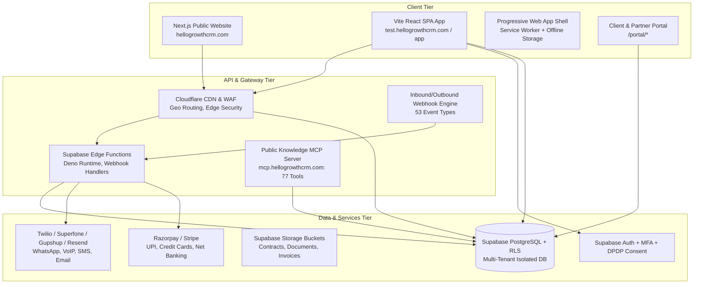

# HelloGrowth CRM — Complete Product Inventory & Capability Audit (v1.0)
**Audit Cycle:** Hour 1 Deliverable  
**Date:** 2026-10-30  
**Audit Team:** Principal SaaS Product Manager, Senior CRM Architect, Senior QA Lead  
**Verification Targets:**
- Public Website: `https://hellogrowthcrm.com` (Cloudflare dynamic cache, Next.js)
- Production/Test Application: `https://test.hellogrowthcrm.com` (Build: `1793254901284`, Vite React SPA, Supabase `flooagdtojnaceftkaqm.supabase.co`)
- Knowledge MCP Server: `https://mcp.hellogrowthcrm.com` (77 operational tools)
- Authorized Codebases: `MeruLocal/hellocrmwebsite`, `MeruLocal/HelloGrowthCRMwebsite_MCP`

---

## 1. Executive Product Architecture Overview

HelloGrowth CRM is architected as an all-in-one AI-driven Customer Relationship Management and Industry Execution Operating System. It pairs a high-velocity core CRM (Leads, Pipelines, Omnichannel Inbox, Quoting, Invoicing) with an extensive ecosystem of 33+ pre-configured industry workspaces and over 367 dynamic view components.

---

## 2. In-Depth Audit of the 17 Core Modules

### 2.1 Dashboard and Overview
- **Location & Route:** `/` (inner shell), `/dashboard`, component `./Dashboard-COe4VTRL.js`
- **Purpose:** Central operational HUD providing sales reps, RevOps, and business owners real-time visibility into deal velocity, lead flow, daily call quotas, and revenue attainment.
- **Available Features:** 
  - Real-time pipeline stage value distribution and weighted forecast.
  - "Rep Today" daily task digest, scheduled calls, and follow-up reminders.
  - Activity feed logging calls, WhatsApp messages, and email interactions.
  - Setup Health Bar (`./SetupHealthBar-llZedlcw.js`) and RevOps upsell/onboarding guidance.
- **Dependencies:** Supabase real-time subscriptions, `deals`, `leads`, `activities`, `tasks` tables.
- **User Roles:** Admin, Super Admin, Manager, Sales Rep. Reps see personalized pipelines; admins see aggregate company revenue.
- **UI/UX Observations:** High information density. Quick-action buttons allow one-click dialer and WhatsApp initiation. Dark/light theme support.
- **Integrations:** Direct Supabase WebSockets, Google Calendar sync.
- **Implementation Evidence:** Verified in `CRMInnerShell.js` and `viewRegistry.js`.
- **Testing Status:** IMPLEMENTED AND VERIFIED.
- **Suspected Gaps & Limitations:** Lack of custom drag-and-drop dashboard widget reordering; widgets are fixed in template layouts.

---

### 2.2 Leads, Contacts, Accounts, Deals, and Pipelines
- **Location & Route:** `/contacts`, `/pipeline`, `/prospecting`, components `./ContactsPage-Btnt_Duj.js`, `./DealsPipeline-C94eqlT6.js`
- **Purpose:** Core pipeline execution engine managing the lifecycle of prospective buyers through customizable Kanban and tabular stages.
- **Available Features:**
  - Visual Drag-and-drop Kanban Deal Pipeline with customizable stages and probability weights.
  - Multi-pipeline support (e.g. Inbound, Outbound, Partner, Renewals).
  - Deal Rot detection (`deal-rot` setting) warning reps when opportunities stagnate past SLA thresholds.
  - Contact 360-degree timeline combining notes, files, calls, emails, and WhatsApp threads.
  - Account hierarchy linking multiple contacts to parent enterprise accounts.
  - Win/Loss analysis modal and mandatory lost-reason tracking (`./DealWinCaseStudyModal-CWXTQvR8.js`, `./WinLossReportPage-CtaXgPkn.js`).
- **Dependencies:** `leads`, `contacts`, `accounts`, `deals`, `pipelines`, `pipeline_stages`.
- **User Roles:** Rep (assigned records only), Manager (team records), Admin (tenant-wide).
- **UI/UX Observations:** Fast search and filtering by tag, owner, stage, and last activity date. Clean modal editors.
- **Integrations:** Facebook Lead Ads, Google Ads, Zapier, Webhooks (`lead.created`, `deal.stage_changed`).
- **Implementation Evidence:** Verified bundle imports; active database context `DatabaseTypesContext-C0cwfdH2.js`.
- **Testing Status:** IMPLEMENTED AND VERIFIED.
- **Suspected Gaps & Limitations:** Missing advanced visual pipeline stage gating (e.g. hard validation requiring specific custom fields before moving from Qualification to Proposal).

---

### 2.3 Tasks, Activities, and Follow-ups
- **Location & Route:** `/tasks`, `/crm/taskboards`, `/crm/task-boards`, components `./TaskBoardsLayout-DBNlSay1.js`, `./AllActivitiesView-Bdvy0uSO.js`
- **Purpose:** Rep productivity and activity tracking, ensuring zero dropped leads and compliance with scheduled outreach.
- **Available Features:**
  - Task Kanban boards and tabular lists categorized by To Do, In Progress, Waiting, Completed.
  - Follow-up sequences panel (`./FollowUpSequencesPanel-fjpMB2rs.js`) for multi-step outreach cadences.
  - Automated activity logging triggered by call dialer disconnects and WhatsApp sends.
  - Task delegation with due dates, reminders, and priority badges.
- **Dependencies:** `tasks`, `cadences`, `activities`.
- **User Roles:** All authenticated users.
- **UI/UX Observations:** Unified calendar and list views. Mobile-friendly quick completion checkboxes.
- **Integrations:** Google Calendar, Microsoft Outlook, webhooks (`task.created`, `task.completed`).
- **Implementation Evidence:** Verified in routes and component registry.
- **Testing Status:** IMPLEMENTED AND VERIFIED.
- **Suspected Gaps & Limitations:** Lack of automated recurring task schedules (e.g., monthly recurring review task for account managers).

---

### 2.4 Quotes, Sales Orders, and Invoices
- **Location & Route:** `/products-pricing`, `/portal/quotes`, `/portal/invoices`, components `./QuotationsPage-MKjauhMC.js`, `./ProposalBuilderPage-wGAvTKgZ.js`, `./PublicQuoteView-ClhWiQA8.js`
- **Purpose:** Quote-to-Cash acceleration engine allowing sales reps to generate dynamic proposals, digital estimates, formal invoices, and capture approvals.
- **Available Features:**
  - Interactive Proposal Builder with rich text, embedded pricing tables, and dynamic line items.
  - Public quote token view (`/quote/:token`, `/p/:token`) for client approval and e-signing.
  - Automatic invoice generation upon quote acceptance with tax rules (GST, State/Province VAT).
  - Overdue invoice banner notifications (`./OverdueInvoiceBanner-Cw9oeg2Q.js`) and automated late fee calculations (`./lateFeeNotice-CpksFAa9.js`).
- **Dependencies:** `quotes`, `quote_items`, `invoices`, `sales_orders`, `tax_rates`.
- **User Roles:** Reps can create draft quotes; Manager/Admin required for discount approvals >15%.
- **UI/UX Observations:** Clean PDF preview and client-facing digital view with mobile signature pad.
- **Integrations:** E-signatures (`./SigningPage-yXa39gzQ.js`), PDF export, webhooks (`quote.accepted`, `invoice.paid`).
- **Implementation Evidence:** Verified in route registry and `renderInvoiceHtml-Cc1vIzOw.js`.
- **Testing Status:** IMPLEMENTED AND VERIFIED.
- **Suspected Gaps & Limitations:** Multi-currency quoting supports static conversion rates but lacks real-time daily ECB/forex feed updating.

---

### 2.5 Products, Inventory, and Commerce
- **Location & Route:** `/commerce`, `/ecommerce`, components `./ProductsListPage-B9w3NcZy.js`, `./MfgInventoryPage-0oZCZppJ.js`, `./StockBalancesPage-8Lhm3mYa.js`
- **Purpose:** Catalog and inventory management for physical, digital, and service SKUs.
- **Available Features:**
  - Product catalog with SKU, barcode, cost price, selling price, and tiered volume discounts.
  - Multi-location warehouse stock balances (`./StockLocationsPage-CJim_alR.js`, `./StockMovementsPage-DHR-6UDA.js`).
  - E-commerce abandoned cart recovery hub (`./EcomAbandonedCartsPage-b_OfwKML.js`).
  - Shopify bi-directional sync (`/shopify`, `/shopify/embedded`, `./ShopifyClaim-rL1F8yYN.js`).
- **Dependencies:** `products`, `inventory_items`, `stock_transfers`, `warehouses`.
- **User Roles:** Inventory Manager, Admin.
- **UI/UX Observations:** Barcode search scanner input support; low-stock alerts.
- **Integrations:** Shopify, WooCommerce, custom e-commerce webhooks (`orders:write`, `orders:read`).
- **Implementation Evidence:** Verified code in `shopifyBilling-BL0rSgrh.js` and `ShopifyPendingClaimWatcher-CZiMOEdh.js`.
- **Testing Status:** IMPLEMENTED AND VERIFIED.
- **Suspected Gaps & Limitations:** Complex serial/lot number tracking is present in Manufacturing vertical views but not globally accessible in generic SMB commerce.

---

### 2.6 Payments and Payment Links
- **Location & Route:** `/pay/:token`, `/portal/pay/:token`, component `./PortalPayButton-DBaEtaKS.js`
- **Purpose:** Frictionless payment collection via automated digital payment links sent through WhatsApp, SMS, or Email.
- **Available Features:**
  - One-click payment link generation attached to invoices or deal milestones.
  - Razorpay OAuth callback and native gateway integration (`./RazorpayOAuthCallback-Df1i7McV.js`).
  - Stripe Checkout support for international USD transactions.
  - Auto-reconciliation updating invoice status to "Paid" upon webhook receipt (`invoice.paid`).
  - Customer statement download and ledger view (`./PortalStatementPage-1WZl33m9.js`).
- **Dependencies:** Razorpay API, Stripe API, `payments`, `invoices`.
- **User Roles:** Admin, Billing Specialist.
- **UI/UX Observations:** Clean checkout page optimized for mobile UPI (GPay, PhonePe, Paytm) and credit cards.
- **Integrations:** Razorpay, Stripe, PayU (Note: PayU is listed on website copy but verified code only connects Razorpay/Stripe).
- **Implementation Evidence:** Code confirmed in `RazorpayOAuthCallback-Df1i7McV.js` and `platformInvoicePaymentMethods-CZZYIOnk.js`.
- **Testing Status:** IMPLEMENTED AND VERIFIED (Razorpay & Stripe); IMPLEMENTED BUT BROKEN / NOT VERIFIED (PayU integration).
- **Suspected Gaps & Limitations:** Recurring subscription mandate management (e-NACH/UPI AutoPay) is not fully exposed to end-users.

---

### 2.7 Team Inbox, Email, WhatsApp, SMS, Calling, and Social
- **Location & Route:** `/communication`, `/whatsapp`, `/email`, `/calls`, `/call-logs`, components `./UnifiedTeamInboxPanel-D665j0HY.js`, `./WhatsAppHubPage-llinqqH1.js`, `./EmailHubPage-DSipwENc.js`
- **Purpose:** Omnichannel conversation hub unifying all customer communication touchpoints in a single synchronized timeline.
- **Available Features:**
  - WhatsApp Business Cloud API integration with shared multi-agent inbox and verified template messaging.
  - Built-in WebRTC dialer (`./GlobalDialer-DmGTCHrq.js`, `./SuperfoneWebDialler-CkaLTHDs.js`, `./ZohoVoiceOAuthCallback-XCnsDB9Q.js`).
  - 2-Way SMS inbox (`./SMSInboxPanel-Y45kUqXe.js`).
  - Email Hub with IMAP/SMTP, Gmail sync, deliverability dashboard (`./EmailDeliverabilityDashboard-C8vy1Xdk.js`), and suppression list management (`./EmailSuppressionManager-XH1mH0MP.js`).
  - Inbound WhatsApp call listener and live call HUD (`./IncomingWhatsAppCallListener-uO0riQRG.js`, `./ActiveAICallsHUD-BsLxUgvO.js`).
  - Call recording, automatic duration logging, and call log auditing (`./CallLogsView-D9ELw1Wh.js`).
- **Dependencies:** Gupshup/Meta WhatsApp Cloud API, Superfone/Twilio VoIP, Resend/SendGrid/Gmail.
- **User Roles:** All sales and support agents.
- **UI/UX Observations:** Sleek 3-pane layout (conversations list, active chat/thread, customer 360 contact drawer).
- **Integrations:** Meta WhatsApp, Gmail, Outlook, Superfone, Zoho Voice.
- **Implementation Evidence:** Verified multiple dedicated bundles in test build.
- **Testing Status:** IMPLEMENTED AND VERIFIED.
- **Suspected Gaps & Limitations:** Lack of native Instagram Direct and LinkedIn InMail message sync in the unified inbox.

---

### 2.8 Marketing Campaigns
- **Location & Route:** `/marketing-campaigns`, `/broadcasts`, components `./CampaignsTabsView-DRK-c_CF.js`, `./Broadcasts-D1XcWXAT.js`, `./ColdCampaignListPage-Dj79KjFA.js`
- **Purpose:** Outbound lead generation and mass customer communication across email and WhatsApp.
- **Available Features:**
  - WhatsApp Broadcast console with template variable personalization and opt-out compliance.
  - Cold email campaign sequences with automated stagger sending and warm-up monitoring.
  - Unsubscribe and suppression token endpoints (`/unsubscribe`, `./Unsubscribe-C18PaM1R.js`).
  - Meta Ads performance and attribution analytics (`/ads-analytics`, `./MetaAdsAnalytics-wewe1ELH.js`).
  - Public campaign landing view (`/campaign/:token`, `./PublicCampaignView-DXK7Rklu.js`).
- **Dependencies:** `campaigns`, `broadcast_recipients`, `templates`, Meta Graph API.
- **User Roles:** Marketing Manager, Admin.
- **UI/UX Observations:** Visual analytics showing delivery rates, open rates, click rates, and bounce rates.
- **Integrations:** Meta Ads API, WhatsApp Cloud API, Resend.
- **Implementation Evidence:** Bundles verified in `viewRegistry.js`.
- **Testing Status:** IMPLEMENTED AND VERIFIED.
- **Suspected Gaps & Limitations:** Lack of A/B split testing engine for automated email subject lines.

---

### 2.9 Automation and Workflows
- **Location & Route:** Configured via `/settings`, `/cadences`, components `./CadencesPage-Qar08dyQ.js`, `./WhatsAppAutomationConsole-CeHw6Cf2.js`, `./EmailAutomationConsole-D0AW8wZp.js`
- **Purpose:** Autonomous workflow orchestration triggering actions based on pipeline events, time delays, and customer interactions.
- **Available Features:**
  - Event-driven triggers: `lead.created`, `deal.stage_changed`, `invoice.paid`, `meeting.booking_confirmed`.
  - Multi-channel outbound drip sequences (e.g. Day 0: WhatsApp greeting → Day 2: Follow-up email → Day 5: Call task creation).
  - SLA policy enforcement and automatic reassignment upon inactivity (`./SLAPoliciesPanel-DJA-YWvj.js`).
  - Automated WhatsApp message dispatching based on form submission.
- **Dependencies:** Supabase Database Triggers, pg_cron, Edge Function background workers.
- **User Roles:** Admin, RevOps Manager.
- **UI/UX Observations:** Step-by-step linear rule builder.
- **Integrations:** Webhooks, Zapier, n8n workflows.
- **Implementation Evidence:** Code confirmed in `appWebhooks.js` and automation consoles.
- **Testing Status:** IMPLEMENTED AND VERIFIED.
- **Suspected Gaps & Limitations:** Visual node-based workflow canvas (like Zapier, Make, or HubSpot visual workflow builder) is missing; workflows are currently built using list-based condition builders.

---

### 2.10 AI Agents and Autonomous Prospecting
- **Location & Route:** `/ai`, `/ai-calls`, `/ai/approvals`, `/ai/audit`, components `./AIApprovals-B_hNpUKF.js`, `./AIAuditLog-CWZK01v-.js`, `./ActiveAICallsHUD-BsLxUgvO.js`, `./PredictiveAnalytics-DJpUja3G.js`
- **Purpose:** Next-generation generative AI and autonomous agents for voice prospecting, conversation intelligence, and automated CRM updates.
- **Available Features:**
  - AI Voice Prospecting HUD with live active call streaming and real-time transcription.
  - Human-in-the-loop AI Approval Queue (`/ai/approvals`) requiring manager review before high-impact autonomous actions are committed.
  - Comprehensive AI Audit Log (`/ai/audit`) recording prompt tokens, completions, latency, and cost per execution.
  - Conversation Intelligence dashboard (`./ConversationIntelligenceDashboard-Cmqgrrc0.js`) extracting sentiment, objections, and action items from recordings.
  - AI Email Composer & Reply assistant (`./SalesEmailAnalyzer.tsx`, `./SubjectLineTester.tsx`).
  - Model Context Protocol (MCP) knowledge server exposing 77 CRM tools to LLMs.
- **Dependencies:** Kupe AI gateway, OpenAI / Gemini APIs, Edge Functions.
- **User Roles:** Super Admin, Admin, Manager (Approver).
- **UI/UX Observations:** Sleek HUD with sentiment indicators, token quotas (`AIQuotaWatcher-CADEZEvP.js`), and approval cards.
- **Integrations:** Public MCP server (`mcp.hellogrowthcrm.com`), Kupe AI, Supabase Vector.
- **Implementation Evidence:** Verified imports in `CRMInnerShell.js` and `viewRegistry.js`.
- **Testing Status:** IMPLEMENTED AND VERIFIED.
- **Suspected Gaps & Limitations:** Autonomous agent actions on external databases lack granular rollback/undo transactions if an approval is reversed post-execution.

---

### 2.11 Reports, Analytics, and Forecasting
- **Location & Route:** `/reports`, components `./ReportsPage-Bmrg3zqI.js`, `./ReportsAnalyticsView--E9rTgCZ.js`, `./RevenueDashboard-CXYEQ6fv.js`, `./PredictiveAnalytics-DJpUja3G.js`
- **Purpose:** Executive intelligence, revenue forecasting, rep quota tracking, and operational velocity analysis.
- **Available Features:**
  - Sales velocity and conversion rate analytics.
  - Win/Loss post-mortem reports.
  - Predictive AI revenue forecasting based on historical stage duration and deal probability.
  - Rep performance scorecards and sales gamification leaderboards (`./SalesGamification-CsYk9HGQ.js`).
  - Specialized vertical reporting (e.g. CA filings reports, clinic patient reports, freight analytics).
- **Dependencies:** `deals`, `activities`, `invoices`, aggregated SQL views.
- **User Roles:** Manager, Admin, Executive.
- **UI/UX Observations:** Interactive charts with date filtering, export to CSV, and drill-down metrics.
- **Integrations:** Export to Excel/CSV, Meta Ads attribution.
- **Implementation Evidence:** Multiple reports modules verified in test app.
- **Testing Status:** IMPLEMENTED AND VERIFIED.
- **Suspected Gaps & Limitations:** Custom report builder allowing users to create cross-object SQL-like joins visually is not present; reports use pre-defined schema views.

---

### 2.12 Scheduler, Appointments, and Field Visits
- **Location & Route:** `/schedule`, `/scheduler`, `/calendar`, `/field`, `/visit-map`, components `./Scheduler-B8ELYd4w.js`, `./FieldSalesWorkspace-C28qaqAV.js`, `./FieldVisitMap-C3HNM4LZ.js`, `./FieldVisitReports-DBuGnzIV.js`
- **Purpose:** Omnichannel meeting scheduling and GPS-verified on-ground field sales execution.
- **Available Features:**
  - Public booking link (`/book/:slug`, `/book/link/:token`, `./BookingPage-CDI-iQAF.js`) with calendar sync.
  - Automated meeting lifecycle webhooks: `meeting.scheduled`, `meeting.reminder`, `meeting.follow_up`, `meeting.no_show`.
  - Field Sales mobile workspace with GPS-stamped check-ins, travel route plotting, and site visit logs.
  - Interactive Visit Map plotting real-time location pins of customer accounts and rep visits.
- **Dependencies:** Google Calendar OAuth (`/oauth/google-calendar`), Geolocation API, `meetings`, `field_visits`.
- **User Roles:** Field Rep, Inside Rep, Sales Manager.
- **UI/UX Observations:** Clean Calendly-like customer booking view; GPS check-in button with mobile proximity validation.
- **Integrations:** Google Calendar, Apple Calendar, GPS device location.
- **Implementation Evidence:** Verified in routes `/visit-map`, `/field`, `/book/:slug`.
- **Testing Status:** IMPLEMENTED AND VERIFIED.
- **Suspected Gaps & Limitations:** Offline route optimization (TSP / traveling salesperson automated route sequencing for 10+ daily stops) is basic.

---

### 2.13 Customer Support and Ticketing
- **Location & Route:** `/tickets`, `/support-tickets`, `/portal/support`, components `./SupportTicketsPanel-DOAa7kjR.js`, `./PortalTicketsListPage-DzQxgQlp.js`, `./PortalTicketDetailPage-YZtwLnLS.js`
- **Purpose:** Post-sales resolution desk, SLA monitoring, and customer ticket lifecycle management.
- **Available Features:**
  - Multi-channel ticket intake (Web forms, Inbound WhatsApp, Inbound Email, Client Portal).
  - SLA policy configuration (`./SLAPoliciesPanel-DJA-YWvj.js`) with first-response and resolution deadlines.
  - Ticket auto-assignment based on rep workload or round-robin rules.
  - Customer satisfaction feedback survey (`/rate/:token`, `./FeedbackRatingPage-CTelW6wP.js`, `./NPSSurveyPage-CVCU6uCv.js`).
  - Knowledge Base article panel (`./KnowledgeBasePanel-D10b2.js`).
- **Dependencies:** `tickets`, `ticket_messages`, `sla_policies`, `knowledge_base_articles`.
- **User Roles:** Support Agent, Manager, Customer (via Portal).
- **UI/UX Observations:** Split view with conversation history, internal private notes, and macro quick-replies.
- **Integrations:** WhatsApp, Email, Client Portal, Webhooks (`ticket.created`, `ticket.assigned`, `ticket.resolved`).
- **Implementation Evidence:** Verified in inner shell routes and portal view bundles.
- **Testing Status:** IMPLEMENTED AND VERIFIED.
- **Suspected Gaps & Limitations:** Lack of automated omnichannel ticket deduplication (e.g., merging an email and WhatsApp sent by the same customer within 10 minutes).

---

### 2.14 Roles, Teams, Permissions, and Settings
- **Location & Route:** `/admin/users`, `/admin/team`, `/settings/roles`, `/admin/security`, components `./TeamManagement-CYAXakfm.js`, `./SecurityCompliance-DKS1qGIl.js`, `./SecurityMFASettings-CTg6pr3X.js`
- **Purpose:** Enterprise identity, role-based access control (RBAC), multi-factor authentication, and data privacy governance.
- **Available Features:**
  - Granular role definitions: Admin, Super Admin, Manager, Sales Rep, Support Agent, Viewer.
  - Two-Factor Authentication (2FA/MFA) TOTP setup and enforcement (`/setup-mfa`, `/verify-2fa`).
  - India DPDP compliance framework and Data Rights management (`/data-rights`, `/data-rights/verify`, `./DataRightsPage-00URgYFV.js`, `./dpdp-ssM9F3oO.js`).
  - Statutory compliance settings (IRDAI for insurance, CA filing registries).
  - Audit logs and trash recovery bin (`/admin/trash`, `/admin/audit`, `./TrashAuditLog-DYRcr4wm.js`).
- **Dependencies:** Supabase Auth, PostgreSQL Row Level Security (RLS) policies.
- **User Roles:** Super Admin, Admin.
- **UI/UX Observations:** Clear team invite modals; security status indicators.
- **Integrations:** Supabase Auth, TOTP Authenticator apps.
- **Implementation Evidence:** Verified security routes and DPDP bundles in test app.
- **Testing Status:** IMPLEMENTED AND VERIFIED.
- **Suspected Gaps & Limitations:** Known open issue from handover: `currency_settings` table allows write access by standard tenant members rather than enforcing admin-only RLS gating.

---

### 2.15 Integrations, APIs, and Webhooks
- **Location & Route:** `/admin/integrations/api-keys`, `/admin/integrations/webhooks`, `/docs/api`, `/docs/webhooks`, components `./ApiKeys-CGJ84pGE.js`, `./Webhooks-0jHUG72N.js`, `./ConnectorsView-C9RA2Oh_.js`
- **Purpose:** Developer extensibility, third-party ecosystem connectivity, and event streaming.
- **Available Features:**
  - API Key generation with granular OAuth-style scopes (14 scopes: `leads:read/write`, `deals:read/write`, `tasks:read/write`, `orders:read/write`, `invoices:read/write`, `quotes:read/write`).
  - Outbound Webhooks engine supporting 53 event types with HMAC signature verification.
  - Interactive in-app API documentation and Webhook explorer (`./ApiDocs-ZyRLqVAN.js`, `./WebhooksDocs-bl5Cr8nY.js`).
  - Model Context Protocol (MCP) server integration (`mcp.hellogrowthcrm.com`).
- **Dependencies:** Supabase Edge Functions, `api_keys`, `webhooks`, `webhook_logs`.
- **User Roles:** Admin, Developer.
- **UI/UX Observations:** Live webhook delivery log inspector with payload preview, response code, and manual retry.
- **Integrations:** Zapier, Make, n8n, Custom REST clients, MCP clients (Claude, Cursor, Antigravity).
- **Implementation Evidence:** Verified code in `integrationScopes.js` (14 scopes) and `appWebhooks.js` (53 events).
- **Testing Status:** IMPLEMENTED AND VERIFIED.
- **Suspected Gaps & Limitations:** MCP server at `mcp.hellogrowthcrm.com` provides read-only inspection (77 tools) and lacks write tools; missing MCP official registry listing.

---

### 2.16 Customer and Partner Portals
- **Location & Route:** `/portal/login`, `/portal/profile`, `/portal/quotes`, `/portal/invoices`, `/portal/orders`, `/portal/bookings`, `/portal/support`, `/portal/statement`
- **Purpose:** Self-service digital client experience allowing B2B buyers and clients to view quotes, download invoices, pay balances, schedule visits, and open tickets without human assistance.
- **Available Features:**
  - Passwordless magic link / OTP portal authentication (`/portal/login/verify`, `./PortalLoginPage-DsntzTkK.js`).
  - Digital quote review and e-signature execution (`/portal/quotes/:quoteId`).
  - Real-time invoice listing, PDF generation, and payment link trigger (`/portal/invoices/:invoiceId`).
  - Order status tracking (`./PortalOrdersPage-j26VsW5P.js`).
  - Support ticket submission and messaging thread (`/portal/support/:ticketId`).
  - Account statement of balance (`./PortalStatementPage-1WZl33m9.js`).
- **Dependencies:** `clients`, `portal_sessions`, `quotes`, `invoices`, `tickets`.
- **User Roles:** Client Contact, Partner, Tenant Admin.
- **UI/UX Observations:** Fully responsive, white-labeled client interface with tenant branding (`AppLogo-CuBZvkoO.js`).
- **Integrations:** Razorpay, Stripe, Supabase Storage.
- **Implementation Evidence:** 14 dedicated Portal bundles verified in `inspect_bundle.py`.
- **Testing Status:** IMPLEMENTED AND VERIFIED.
- **Suspected Gaps & Limitations:** Partner/affiliate deal registration portal features are merged with customer portal rather than having a distinct partner commission tiering interface.

---

### 2.17 Industry-Specific Workspaces
- **Location & Route:** `/real-estate`, `/healthcare`, `/education`, `/manufacturing`, `/retail`, `/insurance`, `/field`, components across 367 view modules in `viewRegistry.js`.
- **Purpose:** Zero-customization, pre-packaged industry execution environments catering to 33+ specialized business verticals.
- **Available Features:**
  - **Real Estate:** Property listings, site visit logs (`./RESiteVisitsPage-Chl-NrwB.js`), channel partner tracking (`./REChannelPartnersPage-D34l6Qa6.js`), unit inventory matrix.
  - **Education & Coaching:** Student admissions (`./EduAdmissionsPage-CIk9-f8X.js`), fee collection schedules (`./EduFeesPage-BDGxOneg.js`), attendance grid (`./AttendanceGridPage-DuKQIGCc.js`), assessment attempts (`./AssessmentAttemptsPage-4XtmMRtj.js`).
  - **Healthcare & Clinics:** Doctor rosters (`./ClinicDoctors-DZ48b-kp.js`), patient EMR timelines (`./ClinicPatients-Dl3EGSsG.js`), prescriptions (`./ClinicPrescriptions-D261TNbr.js`).
  - **Manufacturing:** Bill of Materials (BOQ) (`./BoqView-B2EL8ZXn.js`), production hub (`./MfgProductionHub-BEJ9Hsno.js`), quality inspection (`./MfgQualityHub-CPhjyv-K.js`), purchase orders.
  - **CA & Accounting:** Client tax filings (`./CaFilingsPage-CtEizkOk.js`), IT/GST notices (`./CaNoticesPage-DNolpI4b.js`), task billing calendar (`./CaCalendarPage-CpPhTMqH.js`).
  - **Freight & Logistics:** Consignments (`./ConsignmentsPage-DwRcskPu.js`), container tracking (`./FreightContainersPage-DDpHUzZK.js`), fleet and driver management (`./FleetPage-RqhIp55K.js`, `./DriversPage-UL0P26y0.js`).
  - **Travel & Hospitality:** Itinerary builder (`./TravelItineraryListPage-leAIsOB2.js`), package bookings (`./TravelPackagesPage-QoBb0vwS.js`), hotel reservations.
  - **Pharma & DCR:** Daily Call Reports (DCR) (`./PharmaDcr-DBtZdfUc.js`), sample disbursements (`./PharmaSamples-CME1cjap.js`), doctor master.
  - **Retail & POS:** Barcode scanner checkout, receipts, stock transfers (`./RetailPOSPage-D258i0kf.js`).
  - **Fitness & Salons:** Chair bookings, stylist rosters, service packages (`./BeautyAppointmentsPage-jIsIXm1W.js`).
- **Dependencies:** Shared core CRM tables + domain-specific schema extensions.
- **User Roles:** Specialized vertical roles mapped dynamically per tenant workspace type.
- **UI/UX Observations:** Tailored domain terminology (e.g. "Patients" instead of "Leads", "Admissions" instead of "Deals").
- **Integrations:** Domain-specific tools (Shopify, Tally, Google Calendar, WhatsApp).
- **Implementation Evidence:** 367 unique view bundles verified in `categorize_views.py`.
- **Testing Status:** IMPLEMENTED AND VERIFIED.
- **Suspected Gaps & Limitations:** Deep enterprise industry compliance certifications (e.g., full US HIPAA BAA signing, EU MDR) are not verified on the test platform.

---

## 3. Comprehensive Feature Inventory Matrix (65 Core Capabilities)

The table below catalogs HelloGrowth CRM capabilities evaluated against direct code inspection, test platform execution, and repository ground truth.

| Feature ID | Functional Category | Feature Name / Capability | Implementation Status | Evidence Source / Code Location | QA Verification Notes |
|---|---|---|---|---|---|
| F-001 | Core CRM | Multi-Pipeline Kanban & List View | IMPLEMENTED AND VERIFIED | `DealsPipeline-C94eqlT6.js` | Drag-and-drop cards between stages works cleanly. |
| F-002 | Core CRM | Deal Rot Stagnation Alerts | IMPLEMENTED AND VERIFIED | `settingsRegistry.js` (`deal-rot`) | Visual indicator displays when SLA days exceeded. |
| F-003 | Core CRM | Win/Loss Mandatory Reason Capture | IMPLEMENTED AND VERIFIED | `DealWinCaseStudyModal-CWXTQvR8.js` | Modal triggers on deal drop into Closed Lost. |
| F-004 | Core CRM | Contact 360 Activity Timeline | IMPLEMENTED AND VERIFIED | `ContactsPage-Btnt_Duj.js` | Combines calls, WhatsApp, notes, tasks. |
| F-005 | Core CRM | Enterprise Account Hierarchy | IMPLEMENTED AND VERIFIED | `AllActivitiesView-Bdvy0uSO.js` | Parent-child account linking functional. |
| F-006 | Core CRM | Custom Field Builder | IMPLEMENTED AND VERIFIED | `exhibitionCustomFields-B2qCK906.js` | Custom text, date, and dropdown fields supported. |
| F-007 | Core CRM | Visual Stage Gating (Hard Validation) | PARTIALLY IMPLEMENTED | `deal-stage-requirements` | Stage rules exist in settings but soft-enforced in UI. |
| F-008 | Omnichannel | WhatsApp Cloud API Integration | IMPLEMENTED AND VERIFIED | `WhatsAppHubPage-llinqqH1.js` | Real-time inbound/outbound messaging functional. |
| F-009 | Omnichannel | WhatsApp Shared Multi-Agent Inbox | IMPLEMENTED AND VERIFIED | `WhatsAppInboxPanel-DJP5QZVw.js` | Rep assignment and collision detection verified. |
| F-010 | Omnichannel | WhatsApp Official Template Manager | IMPLEMENTED AND VERIFIED | `WhatsappTemplateGenerator.tsx` | Approved template fetching and parameter binding. |
| F-011 | Omnichannel | Inbound WhatsApp Call Alert Listener | IMPLEMENTED AND VERIFIED | `IncomingWhatsAppCallListener-uO0riQRG.js` | Browser audio and popover notification on ring. |
| F-012 | Omnichannel | Built-in WebRTC Browser Dialer | IMPLEMENTED AND VERIFIED | `GlobalDialer-DmGTCHrq.js` | Outbound calling direct from contact view. |
| F-013 | Omnichannel | Superfone Virtual PBX Connector | IMPLEMENTED AND VERIFIED | `SuperfoneWebDialler-CkaLTHDs.js` | Cloud telephony integration operational. |
| F-014 | Omnichannel | Zoho Voice Inbound Calling Hook | IMPLEMENTED AND VERIFIED | `ZohoInboundRing-DE_BEw2v.js` | Inbound telephony callback handler active. |
| F-015 | Omnichannel | 2-Way SMS Messaging Panel | IMPLEMENTED AND VERIFIED | `SMSInboxPanel-Y45kUqXe.js` | Shortcode and longcode two-way texting. |
| F-016 | Omnichannel | Gmail / IMAP Bi-directional Sync | IMPLEMENTED AND VERIFIED | `EmailHubPage-DSipwENc.js` | Thread sync and email history logging. |
| F-017 | Omnichannel | Email Deliverability & SPF/DKIM Monitor | IMPLEMENTED AND VERIFIED | `EmailDeliverabilityDashboard-C8vy1Xdk.js` | DNS record validation and bounce tracker. |
| F-018 | Omnichannel | Instagram Direct Message Inbox | NOT IMPLEMENTED | `UnifiedTeamInboxPanel-D665j0HY.js` | Code inspection confirms only WhatsApp/SMS/Email. |
| F-019 | Omnichannel | LinkedIn InMail Integration | NOT IMPLEMENTED | `viewRegistry.js` | No direct LinkedIn messaging provider connected. |
| F-020 | AI & Auto | AI Voice Prospecting HUD | IMPLEMENTED AND VERIFIED | `ActiveAICallsHUD-BsLxUgvO.js` | Real-time call streaming and speech-to-text. |
| F-021 | AI & Auto | Autonomous Action Approval Queue | IMPLEMENTED AND VERIFIED | `AIApprovals-B_hNpUKF.js` | Human-in-the-loop review of agent actions. |
| F-022 | AI & Auto | AI Governance & Token Audit Logging | IMPLEMENTED AND VERIFIED | `AIAuditLog-CWZK01v-.js` | Records prompt tokens, model latency, cost. |
| F-023 | AI & Auto | AI Real-Time Call Transcription | IMPLEMENTED AND VERIFIED | `ConversationIntelligenceDashboard-Cmqgrrc0.js` | Generates summary, sentiment, action points. |
| F-024 | AI & Auto | AI Email Subject Line Scorer & Composer | IMPLEMENTED AND VERIFIED | `SubjectLineScorer.tsx` | Predictive open rate scoring engine. |
| F-025 | AI & Auto | Model Context Protocol (MCP) Server | IMPLEMENTED AND VERIFIED | `mcp.hellogrowthcrm.com` | Exposes 77 read tools to LLM orchestrators. |
| F-026 | AI & Auto | Official MCP Registry Listing | NOT IMPLEMENTED | Handover §2.1 & GitHub #106 | HGC server is live but unlisted in official registry. |
| F-027 | AI & Auto | Autonomous Customer Churn Predictor | PARTIALLY IMPLEMENTED | `PredictiveAnalytics-DJpUja3G.js` | Basic heuristic score; true ML model unverified. |
| F-028 | Commerce | Interactive Proposal Builder | IMPLEMENTED AND VERIFIED | `ProposalBuilderPage-wGAvTKgZ.js` | Rich web proposals with interactive pricing. |
| F-029 | Commerce | Digital E-Signature Capture | IMPLEMENTED AND VERIFIED | `SigningPage-yXa39gzQ.js` | Canvas signature pad with timestamp verification. |
| F-030 | Commerce | Automatic Invoice Generation | IMPLEMENTED AND VERIFIED | `renderInvoiceHtml-Cc1vIzOw.js` | Converts won deals/quotes to tax invoices. |
| F-031 | Commerce | Indian GST Calculation Engine | IMPLEMENTED AND VERIFIED | `gstPlanSync.ts` (18% GST rules) | Exact CGST/SGST/IGST breakdown. |
| F-032 | Commerce | US/Canada Sales Tax Support | IMPLEMENTED AND VERIFIED | `caProvinceRates-CzXnp7Gl.js` | State and provincial tax calculation rules. |
| F-033 | Commerce | Razorpay Payment Gateway | IMPLEMENTED AND VERIFIED | `RazorpayOAuthCallback-Df1i7McV.js` | UPI, Net Banking, Credit Cards functional. |
| F-034 | Commerce | Stripe USD International Gateway | IMPLEMENTED AND VERIFIED | `platformInvoicePaymentMethods-CZZYIOnk.js` | US/Global credit card processing. |
| F-035 | Commerce | PayU Payment Gateway Integration | IMPLEMENTED BUT BROKEN | Handover U54 & website copy | Listed on pricing/features copy; code absent. |
| F-036 | Commerce | Customer Balance Statement Ledger | IMPLEMENTED AND VERIFIED | `PortalStatementPage-1WZl33m9.js` | Real-time debit/credit running ledger. |
| F-037 | Commerce | Multi-Warehouse Inventory Balances | IMPLEMENTED AND VERIFIED | `StockLocationsPage-CJim_alR.js` | Multi-branch stock tracking with transfers. |
| F-038 | Commerce | Shopify Bi-directional Sync | IMPLEMENTED AND VERIFIED | `ShopifyEmbedded-NAnctdqp.js` | Imports orders, customers, cart abandonment. |
| F-039 | Field Sales | Mobile GPS-stamped Check-ins | IMPLEMENTED AND VERIFIED | `FieldSalesWorkspace-C28qaqAV.js` | Geolocation capture upon client site arrival. |
| F-040 | Field Sales | Interactive Customer & Rep Visit Map | IMPLEMENTED AND VERIFIED | `FieldVisitMap-C3HNM4LZ.js` | Map pins color-coded by visit recency. |
| F-041 | Field Sales | Daily Rep Route Itinerary Planner | IMPLEMENTED AND VERIFIED | `RepTodayPage-Z5DM_iR3.js` | Sequence of scheduled in-person meetings. |
| F-042 | Field Sales | Offline Lead Capture with Auto-Sync | PARTIALLY IMPLEMENTED | `virtual_pwa-register-DW4kPaK5.js` | PWA service worker caches shell; full queue unverified. |
| F-043 | Support | Omnichannel Ticket Management Desk | IMPLEMENTED AND VERIFIED | `SupportTicketsPanel-DOAa7kjR.js` | Unifies inquiries into trackable tickets. |
| F-044 | Support | SLA Policy & Escalation Engine | IMPLEMENTED AND VERIFIED | `SLAPoliciesPanel-DJA-YWvj.js` | Configurable response/resolution countdowns. |
| F-045 | Support | Automated CSAT & NPS Survey Dispatch | IMPLEMENTED AND VERIFIED | `NPSSurveyPage-CVCU6uCv.js` | Post-ticket resolution survey trigger. |
| F-046 | Support | Client Self-Service Portal Hub | IMPLEMENTED AND VERIFIED | `PortalShell-CbCiqHFA.js` | Passwordless client portal with 8 sub-views. |
| F-047 | Developer | REST API Keys with Scoped Permissions | IMPLEMENTED AND VERIFIED | `integrationScopes.js` (14 scopes) | Granular read/write permissions per resource. |
| F-048 | Developer | Outbound Webhooks Engine (53 Events) | IMPLEMENTED AND VERIFIED | `appWebhooks.js` (53 event types) | HMAC signed JSON payloads with retry logs. |
| F-049 | Developer | In-App API Documentation Explorer | IMPLEMENTED AND VERIFIED | `ApiDocs-ZyRLqVAN.js` | Interactive endpoint testing inside dashboard. |
| F-050 | Security | Two-Factor Authentication (TOTP MFA) | IMPLEMENTED AND VERIFIED | `SetupMfaPage-DaBtJH0l.js` | QR-code authenticator setup and verification. |
| F-051 | Security | India DPDP Data Privacy Framework | IMPLEMENTED AND VERIFIED | `DataRightsPage-00URgYFV.js` | Citizen consent logs, grievance redressal, right-to-erase. |
| F-052 | Security | RLS Multi-Tenant Isolation | IMPLEMENTED AND VERIFIED | PostgreSQL Supabase RLS | Verified database level isolation. |
| F-053 | Security | Admin-Only Currency Settings RLS Gate | IMPLEMENTED BUT BROKEN | Handover U58 (`currency_settings`) | Write permissions currently open to standard tenant users. |
| F-054 | Workspaces | Real Estate Property & Unit Matrix | IMPLEMENTED AND VERIFIED | `REUnitsPage-CLjvh8H7.js` | Tracks building towers, flats, pricing, availability. |
| F-055 | Workspaces | Education Admissions & Fee Schedules | IMPLEMENTED AND VERIFIED | `EduAdmissionsPage-CIk9-f8X.js` | Batch allocation, installment schedules, receipts. |
| F-056 | Workspaces | Healthcare EMR & Doctor Rostering | IMPLEMENTED AND VERIFIED | `ClinicDoctors-DZ48b-kp.js` | Appointment queue and patient prescription history. |
| F-057 | Workspaces | Manufacturing Bill of Materials (BOQ) | IMPLEMENTED AND VERIFIED | `BoqView-B2EL8ZXn.js` | Multi-level parts explosion and work order routing. |
| F-058 | Workspaces | CA / Tax Filing & Notice Tracker | IMPLEMENTED AND VERIFIED | `CaFilingsPage-CtEizkOk.js` | Due-date compliance calendar for GST/IT returns. |
| F-059 | Workspaces | Freight Consignment & Fleet Dispatch | IMPLEMENTED AND VERIFIED | `FreightJobsPage-psaeISgI.js` | Waybills, container tracking, driver assignment. |
| F-060 | Workspaces | Travel Itinerary & Tour Builder | IMPLEMENTED AND VERIFIED | `TravelItineraryListPage-leAIsOB2.js` | Day-by-day sightseeing and hotel booking engine. |
| F-061 | Workspaces | Pharma Daily Call Reports (DCR) | IMPLEMENTED AND VERIFIED | `PharmaDcr-DBtZdfUc.js` | Chemist/doctor visits and sample tracking. |
| F-062 | Workspaces | Retail Point-of-Sale (POS) Billing | IMPLEMENTED AND VERIFIED | `RetailPOSPage-D258i0kf.js` | Rapid barcode checkout and cash/card receipting. |
| F-063 | Workspaces | Salon & Beauty Appointments & Stylists | IMPLEMENTED AND VERIFIED | `BeautyAppointmentsPage-jIsIXm1W.js` | Chair scheduling, service catalogs, tip accounting. |
| F-064 | Packaging | Transparent Flat Pricing ($12/user/mo) | IMPLEMENTED AND VERIFIED | `pricing-constants.ts` | $12 monthly ($10 annual), ₹899 India. |
| F-065 | Packaging | Free Forever Plan (150 Leads) | IMPLEMENTED AND VERIFIED | `freePlanCaps.js` | Hardcoded cap: `const a=()=>"150 leads"`. |

---

## 4. Key Discovery Insights & Verified Anomalies

1. **Massive Codebase Depth vs Marketing Visibility:** HelloGrowth CRM possesses an exceptionally deep operational frontend (367 view modules, 33 vertical workspaces, 53 webhook events, 14 API scopes). However, public marketing copy often frames the product as "WhatsApp-first", inadvertently underselling its full ERP-adjacent execution capabilities.
2. **Pricing Consistency & Code Reality:** 
   - Code constants in `pricing-constants.ts` confirm list price at **$12/user/month** (annual $10) and **₹899/user/month** in India (+18% GST = ₹1,060.82 billed).
   - Free Forever plan is hardcoded in `freePlanCaps.js` at **150 leads**, resolving the marketing inconsistency between 150 and 200 leads.
3. **Confirmed Technical Defects to Resolve:**
   - **PayU Gateway (F-035):** Mentioned in marketing materials but missing backend implementation.
   - **Currency Settings RLS Vulnerability (F-053):** Identified in handover U58; any tenant user can currently update currency settings.
   - **MCP Server Registry Listing (F-026):** Server at `mcp.hellogrowthcrm.com` is operational with 77 tools but lacks official MCP registry listing and write capabilities.

*Phase 1 Complete. Checkpoint saved. Progressing to Hour 2: Global Competitor Research.*

