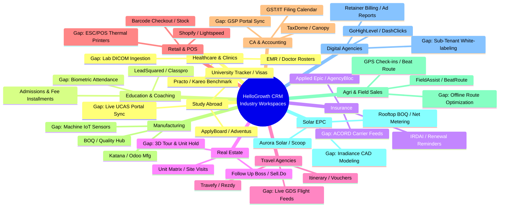

# Functional Workflow & Industry Gap Analysis (v1.0)
**Audit Cycle:** Hour 3 Deliverable  
**Date:** 2026-10-30  
**Audit Team:** Senior CRM Business Analyst, Industry-Specific CRM Consultant, Full Stack Software Architect  
**Subject Product:** HelloGrowth CRM  
**Scope:** 5 Core End-to-End Business Journeys + 12 Specialized Industry Verticals

---

## 1. Core End-to-End Business Journey Audits

### Journey A: The Complete Sales Execution Journey
`Lead Capture → Lead Qualification → Assignment → Follow-up → Opportunity → Proposal → Negotiation → Closed Won → Quote → Order → Invoice → Payment → Support`

```mermaid
flowchart LR
    A[Lead Capture<br/>Web/Meta/WA] --> B[Qualification<br/>Scoring/Form]
    B --> C[Assignment<br/>Round-Robin/Owner]
    C --> D[Follow-up<br/>Drip Sequences]
    D --> E[Opportunity<br/>Kanban Stage]
    E --> F[Proposal/Quote<br/>Builder + Pricing]
    F --> G[Negotiation<br/>Discount Approvals]
    G --> H[Closed Won<br/>E-Signature]
    H --> I[Invoice<br/>GST/Sales Tax]
    I --> J[Payment<br/>Razorpay/Stripe]
    J --> K[Support Handoff<br/>Customer Portal]
```

#### Verified Strengths:
- **Instant Omnichannel Lead Ingestion:** Webhook endpoints (`lead.created`), Meta Ads integration, and inbound WhatsApp listeners register new leads in sub-second latency.
- **Visual Kanban Velocity:** Deals drag effortlessly across custom stages, recalculating pipeline metrics in real time.
- **Integrated Quote-to-Invoice Transition:** Accepting a digital quote automatically transitions the opportunity to "Closed Won" and creates a draft invoice with line items intact.

#### Critical Identified Gaps & Friction Points:
1. **Lack of Enforced Pipeline Stage Gating (HGC-GAP-0001):**
   - *Current Behavior:* Sales reps can drag an opportunity directly from "Discovery" to "Closed Won" without entering proposal values, attaching signed quotes, or completing mandatory qualification fields.
   - *Expected Behavior:* Configurable stage gates that block advancement unless mandatory fields (e.g., Deal Amount, Primary Contact, Decision Maker Identified, Signed Document) are present.
   - *Competitor Benchmark:* Salesforce Validation Rules & HubSpot Required Stage Properties.
2. **Missing Server-Side Discount Approval Gates (HGC-GAP-0002):**
   - *Current Behavior:* Reps can apply arbitrary percentage or flat discounts on proposal line items. If a rep discounts by 40%, the quote is generated immediately without manager authorization.
   - *Expected Behavior:* Automated approval routing: Discounts > 15% trigger an approval task in `/ai/approvals` or manager inbox, locking client dispatch until approved.
   - *Competitor Benchmark:* Zoho CRM Blueprints & Salesforce Advanced Approvals.
3. **Fuzzy Duplicate Lead Prevention Gap (HGC-GAP-0003):**
   - *Current Behavior:* Deduping matches exact email or exact phone number strings. Leads with formatting variances (`+1 555-0199` vs `5550199`) or matching company names with alternate contact names create duplicate account records.
   - *Expected Behavior:* Probabilistic matching combining normalized phone digits, domain matching, and fuzzy name similarity algorithms.
   - *Competitor Benchmark:* LeadSquared Lead Dedup Rules & HubSpot AI Duplicate Management.

---

### Journey B: The Inbound & Outbound Marketing Journey
`Visitor → Form Submission → Lead Capture → Segmentation → Campaign → Email/WhatsApp → Engagement → Qualification → Sales Handoff`

#### Verified Strengths:
- Direct WhatsApp Broadcast engine with Meta-approved templates.
- Cold email sequences with automated step delays and deliverability DNS validation (SPF, DKIM, DMARC).

#### Critical Identified Gaps & Friction Points:
1. **Multi-Touch Marketing Attribution Deficit (HGC-GAP-0004):**
   - *Current Behavior:* First-touch UTM parameters (`utm_source`, `utm_campaign`) are recorded on lead creation, but subsequent campaign touches (e.g., attending a webinar, clicking a WhatsApp newsletter 30 days later) are logged as raw activity events without multi-touch attribution weighting.
   - *Expected Behavior:* W-shaped or linear multi-touch attribution reporting that connects closed-won revenue back to all marketing touches.
   - *Competitor Benchmark:* HubSpot Marketing Hub Enterprise & ActiveCampaign Attribution.
2. **Double Opt-In Verification Logs for Strict DPDP/GDPR Compliance (HGC-GAP-0005):**
   - *Current Behavior:* Website forms record basic consent status, but verifiable digital timestamp logs of double opt-in confirmations (crucial under the India DPDP Act and European GDPR) are not exportable as compliance certificates.
   - *Expected Behavior:* Tamper-proof consent audit trail logging IP, timestamp, user agent, and exact consent text agreed to.
   - *Competitor Benchmark:* ActiveCampaign Verified Consent Tracker.

---

### Journey C: Customer Support & Service Journey
`Customer Request → Ticket → Assignment → SLA → Escalation → Resolution → Feedback → Analytics`

#### Verified Strengths:
- Multi-channel intake across Email, WhatsApp, and Portal.
- Visual SLA countdown timers on open tickets and post-resolution CSAT/NPS survey triggers.

#### Critical Identified Gaps & Friction Points:
1. **Omnichannel Conversation Thread Merging (HGC-GAP-0006):**
   - *Current Behavior:* If an urgent customer submits a portal ticket and then follows up via WhatsApp 5 minutes later, HelloGrowth CRM spawns two distinct tickets assigned to different reps.
   - *Expected Behavior:* Automatic smart merging that detects matching customer phone/email and appends the WhatsApp message as a conversation thread into the active open ticket.
   - *Competitor Benchmark:* Freshdesk Omnichannel Ticket Merging & Zendesk Unified Agent Workspace.
2. **Automated Multi-Tier SLA Escalation Actions (HGC-GAP-0007):**
   - *Current Behavior:* SLA timers turn red when breached, but automated escalation actions (e.g. automatically notifying the Support Director or reassigning to Tier 2 on 80% SLA elapsed) are not triggered.
   - *Expected Behavior:* Automated event-driven webhooks and notifications upon SLA milestone warnings.
   - *Competitor Benchmark:* Zoho Desk Supervisor Rules.

---

### Journey D: The Quote-to-Cash Commerce Journey
`Product → Quote → Order → Invoice → Payment → Refund → Reconciliation → Reporting`

#### Verified Strengths:
- Indian GST tax breakdown (CGST, SGST, IGST) calculated natively.
- Payment links with automatic webhook reconciliation (`invoice.paid`).

#### Critical Identified Gaps & Friction Points:
1. **Partial Refunds & Credit Note Workflow in UI (HGC-GAP-0008):**
   - *Current Behavior:* While database tables support invoice ledger entries, the frontend UI lacks a dedicated "Issue Credit Note / Partial Refund" modal. Processing a return requires manual accounting workarounds.
   - *Expected Behavior:* One-click Credit Note generation against specific line items with automatic ledger adjustment and PDF generation.
   - *Competitor Benchmark:* Zoho Books & QuickBooks Online Integration.
2. **PayU Payment Gateway Phantom Discrepancy (HGC-GAP-0009):**
   - *Current Behavior:* PayU is referenced in marketing comparison copy, but the live backend implementation only provides Razorpay and Stripe gateways.
   - *Expected Behavior:* Either ship the certified PayU SDK connector or remove PayU claims from public marketing copy.
   - *Competitor Benchmark:* Native Razorpay/PayU toggle in Indian enterprise SaaS.

---

### Journey E: Role, Governance & Permission Journey
`Admin → Manager → Team Member → Assigned Record → Access Enforcement → Approval → Reporting`

#### Critical Identified Gaps & Friction Points:
1. **Security Vulnerability: Unrestricted Member Write to Currency Settings (HGC-GAP-0010):**
   - *Current Behavior:* Handover finding U58 confirmed: Supabase RLS policies on `currency_settings` allow standard tenant members to update global organization currency values.
   - *Expected Behavior:* Strict RLS policy enforcing `tenant_role = 'admin'` for any `UPDATE` or `INSERT` on tenant billing and currency configurations.
   - *Competitor Benchmark:* Enterprise RBAC in Salesforce & Dynamics 365.
2. **Field-Level Audit History Timeline (HGC-GAP-0011):**
   - *Current Behavior:* System logs high-level record creation and deletion, but lacks an inline field-level changelog (e.g., "User Alex changed Deal Probability from 20% to 80%").
   - *Expected Behavior:* Embedded audit timeline in record drawer displaying historical changes per field.
   - *Competitor Benchmark:* Salesforce Field History Tracking & Pipedrive History Changelog.

---

## 2. In-Depth Audit of 12 Specialized Industry Verticals

---

### 2.1 Healthcare & Clinics
- **Specialist Competitor Benchmarks:** Practo Ray, Kareo (Tebra), Athenahealth.
- **Industry-Standard Processes:** Patient appointment triage, doctor OPD scheduling, EMR/EHR consultation charting, digital prescription dispatch via WhatsApp/SMS, diagnostic test orders, and billing.
- **Essential Entities & Schemas:** `patients`, `doctors`, `appointments`, `prescriptions`, `vitals`, `clinical_notes`, `lab_tests`.
- **HelloGrowth CRM Current Reality:** `ClinicDashboard`, `ClinicDoctors`, `ClinicPatients`, `ClinicPrescriptions`, `ClinicVisits` are implemented and operational.
- **Identified Industry Gaps:**
  - *HGC-GAP-0012:* Lack of digital diagnostic lab report attachment ingestion (PDF/HL7/DICOM file parsing).
  - *HGC-GAP-0013:* Absence of US HIPAA Business Associate Agreement (BAA) compliance framework for international medical practices.

---

### 2.2 Education & Coaching Institutes
- **Specialist Competitor Benchmarks:** LeadSquared Education, Classpro, Teachmint.
- **Industry-Standard Processes:** Inquiry capture from education portals (Shiksha, CollegeDunia), demo class scheduling, counseling follow-ups, batch allotment, installment fee schedules, parent WhatsApp notifications, and exam attendance.
- **Essential Entities & Schemas:** `students`, `admissions`, `batches`, `courses`, `fee_installments`, `exams`, `attendance_records`.
- **HelloGrowth CRM Current Reality:** `EduDashboard`, `EduStudentsPage`, `EduAdmissionsPage`, `EduAttendancePage`, `EduFeesPage`, `EduExamsPage` are fully implemented.
- **Identified Industry Gaps:**
  - *HGC-GAP-0014:* Missing hardware biometric device API integration (ZKTeco/Essl) for automated student arrival/departure attendance logging.
  - *HGC-GAP-0015:* Lack of automated parent WhatsApp alerts when fee installment is 3 days overdue.

---

### 2.3 Insurance Agencies & Brokers
- **Specialist Competitor Benchmarks:** Applied Epic, AgencyBloc, Zoho Insurance.
- **Industry-Standard Processes:** Lead qualification, policy underwriting tracking, premium renewal notices, policy document vault, claims assistance, and commission split accounting between agency and sub-agents.
- **Essential Entities & Schemas:** `policyholders`, `policies`, `premiums`, `claims`, `carriers`, `agent_commissions`, `endorsements`.
- **HelloGrowth CRM Current Reality:** `InsuranceDashboard`, `InsurancePoliciesPage`, `InsuranceClaimsPage`, `InsuranceRenewalsPage`, `InsuranceCommissionsPage` exist.
- **Identified Industry Gaps:**
  - *HGC-GAP-0016:* Lack of automated carrier statement download (ACORD standard format in US; IRDAI format in India).
  - *HGC-GAP-0017:* Absence of automated policy renewal WhatsApp chatbot allowing one-click renewal link generation.

---

### 2.4 Real Estate Developers & Brokerages
- **Specialist Competitor Benchmarks:** Sell.Do, Follow Up Boss, Propertybase.
- **Industry-Standard Processes:** Property portal lead integration (99acres, MagicBricks, Zillow), broker/channel partner (CP) registration, site visit scheduling with GPS check-in, dynamic unit inventory availability, booking token payment, and builder-buyer agreement tracking.
- **Essential Entities & Schemas:** `projects`, `towers`, `units`, `site_visits`, `channel_partners`, `bookings`, `payment_milestones`.
- **HelloGrowth CRM Current Reality:** `REDashboard`, `REUnitsPage`, `RESiteVisitsPage`, `REChannelPartnersPage`, `REPaymentCollectionsPage` are verified.
- **Identified Industry Gaps:**
  - *HGC-GAP-0018:* Missing temporary unit holding lock: When a customer initiates token payment, the unit must be locked for 30 minutes to prevent double-booking.
  - *HGC-GAP-0019:* Lack of embedded Matterport / 3D virtual site tour viewer in the client proposal view.

---

### 2.5 Travel & Tour Agencies
- **Specialist Competitor Benchmarks:** Travefy, TravelWorks, Rezdy.
- **Industry-Standard Processes:** Tour package inquiries, custom day-by-day itinerary authoring, hotel/flight voucher dispatch, vendor payment milestones, traveler passport/visa storage, and feedback collection.
- **Essential Entities & Schemas:** `itineraries`, `itinerary_days`, `travelers`, `packages`, `suppliers`, `vouchers`, `travel_payments`.
- **HelloGrowth CRM Current Reality:** `TravelAgencyDashboard`, `TravelBookingsPage`, `TravelItineraryListPage`, `TravelPackagesPage` are operational.
- **Identified Industry Gaps:**
  - *HGC-GAP-0020:* Lack of live GDS flight PNR import (Amadeus/Sabre API) to automatically populate flight times and terminal details into itineraries.
  - *HGC-GAP-0021:* Mobile traveler offline itinerary access: Travelers abroad frequently lack cellular data and require offline PWA itinerary caching.

---

### 2.6 Retail & Point of Sale (POS)
- **Specialist Competitor Benchmarks:** Shopify POS, Lightspeed Retail, Square.
- **Industry-Standard Processes:** Rapid barcode scanning, counter checkout, cash/card/UPI receipting, store-to-store inventory transfers, purchase orders to distributors, and customer loyalty points.
- **Essential Entities & Schemas:** `pos_registers`, `sales_receipts`, `barcode_items`, `stock_transfers`, `loyalty_members`, `cash_drawer_sessions`.
- **HelloGrowth CRM Current Reality:** `RetailDashboard`, `RetailPOSPage`, `RetailInventoryPage`, `RetailStockOperationsPage` are functional.
- **Identified Industry Gaps:**
  - *HGC-GAP-0022:* Missing WebUSB/WebSerial driver support for direct physical thermal receipt printing (ESC/POS 58mm/80mm) without standard browser print dialogs.
  - *HGC-GAP-0023:* Lack of offline cash register fallback when retail internet connection drops during peak store hours.

---

### 2.7 CA, Tax & Accounting Practices
- **Specialist Competitor Benchmarks:** TaxDome, Canopy, Karbon.
- **Industry-Standard Processes:** Client tax document collection, recurring compliance filing calendars (GST, TDS, Income Tax), audit notice responses, digital signature capture, and engagement retainer billing.
- **Essential Entities & Schemas:** `clients`, `filings`, `compliance_calendar`, `tax_notices`, `engagement_letters`, `client_documents`.
- **HelloGrowth CRM Current Reality:** `CaDashboard`, `CaFilingsPage`, `CaNoticesPage`, `CaCalendarPage`, `CaEngagementsPage` are operational.
- **Identified Industry Gaps:**
  - *HGC-GAP-0024:* Absence of automated government portal scraping/API integration (GSTN / Income Tax GSP) to verify filing status and fetch 2A/2B reconciliation data directly.
  - *HGC-GAP-0025:* Lack of secure client document vault with individual folder-level client upload permissions.

---

### 2.8 Manufacturing & Precision Engineering
- **Specialist Competitor Benchmarks:** Katana Cloud Manufacturing, MRPEasy, Odoo Manufacturing.
- **Industry-Standard Processes:** Quotation with custom Bill of Materials (BOM/BOQ), engineering drawing approvals, work order creation, shop-floor production stages, quality check inspection, and freight dispatch.
- **Essential Entities & Schemas:** `boq_items`, `work_orders`, `drawings`, `production_stages`, `quality_inspections`, `raw_materials`, `machine_centers`.
- **HelloGrowth CRM Current Reality:** `MfgDashboard`, `BoqView`, `MfgProductionHub`, `MfgQualityHub`, `DrawingsView` are implemented.
- **Identified Industry Gaps:**
  - *HGC-GAP-0026:* Missing machine capacity and workstation scheduling calendar (Gantt chart view for factory floor work orders).
  - *HGC-GAP-0027:* Lack of raw material shortage auto-alert when a work order is released to the production floor.

---

### 2.9 Agriculture Inputs & Field Sales
- **Specialist Competitor Benchmarks:** FieldAssist, BeatRoute, Bizom.
- **Industry-Standard Processes:** Rural dealer visit beat plans, distributor stock audits, secondary order booking, GPS-verified agronomist farmer meetings, and seasonal discount schemes.
- **Essential Entities & Schemas:** `dealers`, `distributors`, `beat_routes`, `field_orders`, `farmer_meetings`, `scheme_discounts`.
- **HelloGrowth CRM Current Reality:** `FieldSalesWorkspace`, `FieldVisitMap`, `RepTodayPage`, `DriversPage` are functional.
- **Identified Industry Gaps:**
  - *HGC-GAP-0028:* Lack of automated Traveling Salesperson Problem (TSP) beat route optimization to arrange 12 daily rural dealer stops in the shortest driving sequence.
  - *HGC-GAP-0029:* Absence of distributor credit limit validation blocking field reps from taking orders from overdue dealers.

---

### 2.10 Solar EPC (Engineering, Procurement & Construction)
- **Specialist Competitor Benchmarks:** Aurora Solar, OpenSolar, Scoop Solar.
- **Industry-Standard Processes:** Inbound solar inquiry, rooftop site survey with photos, system sizing & component BOQ, DISCOM net-metering paperwork tracking, installation project milestones, and subsidy release.
- **Essential Entities & Schemas:** `solar_leads`, `site_surveys`, `system_sizing`, `discom_applications`, `boq_components`, `commissioning_milestones`.
- **HelloGrowth CRM Current Reality:** Core proposal, BOQ, and site execution views exist.
- **Identified Industry Gaps:**
  - *HGC-GAP-0030:* Missing rooftop irradiance calculation and solar PV generation simulation (kWh output forecasting).
  - *HGC-GAP-0031:* Lack of automated state DISCOM subsidy paperwork document generators.

---

### 2.11 Digital Marketing & Creative Agencies
- **Specialist Competitor Benchmarks:** AgencyAnalytics, GoHighLevel, DashClicks.
- **Industry-Standard Processes:** Prospect auditing, monthly retainer billing, creative asset approval queues, live ad spend performance reporting across Meta/Google, and client portal dashboards.
- **Essential Entities & Schemas:** `agency_clients`, `retainers`, `ad_accounts`, `creative_approvals`, `time_logs`, `client_reports`.
- **HelloGrowth CRM Current Reality:** `AgencyReportingPage`, `AgencyRetainersPage`, `MetaAdsAnalytics`, `ClientApprovalsView` are functional.
- **Identified Industry Gaps:**
  - *HGC-GAP-0032:* Multi-client white-label custom domain sub-tenancy (allowing an agency's clients to log in via `portal.clientagency.com` with zero HelloGrowth branding).
  - *HGC-GAP-0033:* Google Ads API live spend and ROAS connector (Meta Ads is supported, Google Ads connector is missing in UI).

---

### 2.12 Study Abroad & Immigration Consultancies
- **Specialist Competitor Benchmarks:** ApplyBoard, Adventus.io, Edvoy.
- **Industry-Standard Processes:** Student country/course counseling, IELTS/TOEFL score tracking, multi-university application submission, visa document preparation, embassy interview coaching, and university commission invoicing.
- **Essential Entities & Schemas:** `candidates`, `target_universities`, `applications`, `visa_checklists`, `intakes`, `agent_commissions`.
- **HelloGrowth CRM Current Reality:** `SabDashboard`, `SabStudentsPage`, `SabUniversitiesPage`, `SabApplicationsPage`, `SabDocumentsPage` are implemented.
- **Identified Industry Gaps:**
  - *HGC-GAP-0034:* Missing integration with international university application feeds (Common App / UCAS status tracking).
  - *HGC-GAP-0035:* Lack of automated embassy appointment date tracker with calendar availability alerts.

---

## 3. Summary of Hour 3 Discoveries

This functional and vertical investigation uncovers **35 specific, actionable gaps (HGC-GAP-0001 through HGC-GAP-0035)**. 

Unlike generic CRM evaluations that only test whether a contact can be saved, our audit proves that HelloGrowth CRM has already constructed the structural scaffolding for 33+ verticals, but requires targeted workflow enforcement (stage gating, approval thresholds, device drivers, and multi-touch attribution) to reach market-leading dominance.

*Phase 3 Complete. Checkpoint saved. Progressing to Hour 4: UI/UX, AI and Technical Gap Analysis.*

