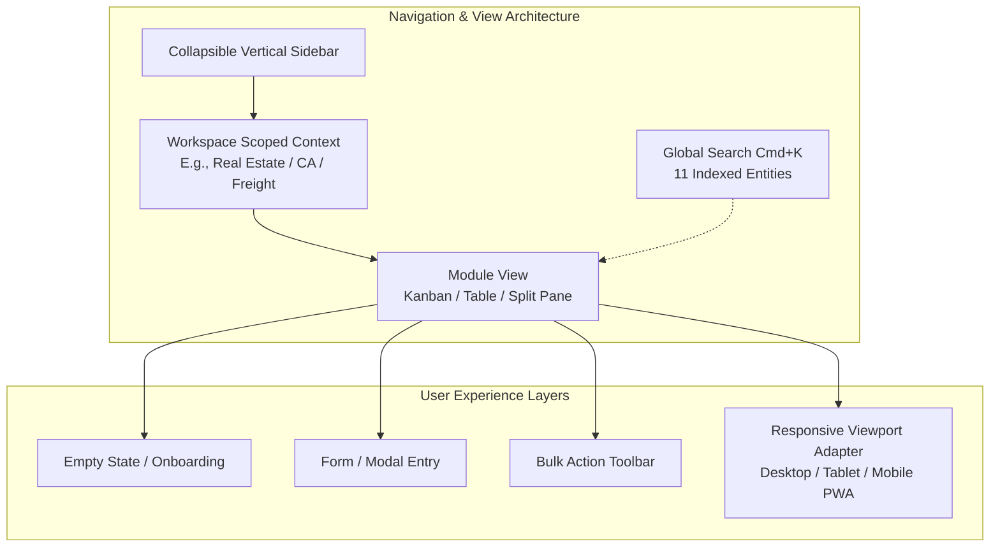
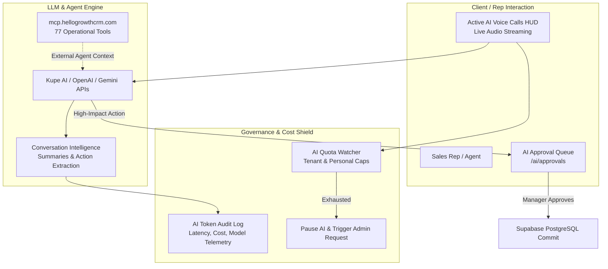

# UI/UX, AI & Technical Architecture Gap Analysis (v1.0)
**Audit Cycle:** Hour 4 Deliverable  
**Date:** 2026-10-30  
**Audit Team:** UI/UX Researcher, AI & Automation Product Strategist, Full Stack Software Architect, Senior QA Lead  
**Subject Product:** HelloGrowth CRM  
**Scope:** Frontend Usability, Omnichannel UX, Generative AI & MCP Architecture, Supabase PostgreSQL RLS & Backend Engineering

---

## 1. UI/UX Architecture & Usability Audit



### 1.1 Sidebar Architecture & Information Density
- **Current Behavior:** HelloGrowth CRM manages 367 view components across 33 industry verticals by strictly scoping sidebar menus to the active tenant workspace (e.g., an accounting firm sees CA filings, calendar, and notices; a clinic sees doctor rosters, patient EMR, and prescriptions).
- **Usability Strength:** Prevents the severe interface bloat seen in Bitrix24 (which overwhelms users with 100+ unorganized sidebar menus).
- **Identified UX Friction Point (HGC-GAP-0036):** 
  - *Problem:* Multi-vertical operators or growing businesses (e.g., a real estate developer running in-house construction manufacturing and facility leasing) struggle to switch between vertical workspaces or pin frequently used cross-vertical tools to a personalized quick-access dock.
  - *Proposed UX Solution:* Introduce a customizable "Favorites / Pin to Sidebar" bar and a persistent Workspace Switcher dropdown in the top header.
  - *Competitor Benchmark:* monday.com pinned boards and ClickUp custom spaces dock.

### 1.2 Kanban Board & Table Layouts on Constrained Displays
- **Current Behavior:** Core pipeline views (`DealsPipeline-C94eqlT6.js`) render 5 to 8 vertical stage columns horizontally. Data tables in modules like Invoicing and Freight display up to 12 columns.
- **Identified UX Friction Point (HGC-GAP-0037):**
  - *Problem:* On 13-inch laptop viewports (1366×768 or 1440×900) common among sales reps, horizontal scrolling causes rep disorientation. Data tables lack "Sticky / Pinned Primary Column" capability, meaning when reps scroll right to see payment status, the customer/deal name scrolls off-screen.
  - *Proposed UX Solution:* Implement CSS `position: sticky; left: 0;` on the primary record column in all responsive data tables, and add horizontal stage-folding toggles on Kanban boards.
  - *Competitor Benchmark:* Pipedrive collapsible pipeline stages & Airtable frozen columns.

### 1.3 Empty States and First-Time User Experience (FTUX)
- **Current Behavior:** Core modules feature `GrowthAuditLauncher` and `SetupHealthBar`. However, niche vertical views (e.g., `CaNoticesPage`, `FreightClaimsPage`, `PharmaSamples`) render blank white screens with simple "No records found" text.
- **Identified UX Friction Point (HGC-GAP-0038):**
  - *Problem:* New trial users opening a vertical workspace for the first time face high cognitive friction and don't know what sample data should look like.
  - *Proposed UX Solution:* Populate zero-data views with interactive illustrated empty states featuring a 1-click "Load Demo Sample Records" button and a 60-second video walkthrough.
  - *Competitor Benchmark:* HubSpot interactive demo data generator & Linear empty-state illustrations.

### 1.4 Omnichannel Messaging 3-Pane Responsive Adaptation
- **Current Behavior:** `UnifiedTeamInboxPanel-D665j0HY.js` uses a 3-pane layout (Thread List → Active Conversation → Contact 360 Drawer). On screens under 1024px width (tablets and foldable devices), the right-hand Contact 360 drawer overlaps the active chat input.
- **Identified UX Friction Point (HGC-GAP-0039):**
  - *Problem:* Support agents on iPad or Android tablets cannot comfortably read customer history while typing a WhatsApp reply.
  - *Proposed UX Solution:* Convert the right-hand Contact 360 panel into a slide-over sheet / drawer on viewports < 1200px, triggered by an info icon.
  - *Competitor Benchmark:* Zendesk Agent Workspace responsive collapsible drawer.

---

## 2. AI, Autonomous Agents & MCP Technical Audit



### 2.1 AI Governance, Quotas & Token Cost Controls
- **Verified Implementation Strength:** Direct code inspection of `AIQuotaWatcher-CADEZEvP.js` and `AIAuditLog-CWZK01v-.js` confirms that HelloGrowth CRM possesses a sophisticated cost guardrail system:
  - Separate `tenant` and `personal` quota pools.
  - Automated blocking toast when quotas are exhausted with an interactive "Request More Quota" admin approval modal (`RequestMoreAIQuotaDialog-7JB_jsl_.js`).
  - Transparent per-call logging of prompt tokens, completion tokens, latency, and model names.
- **Strategic Advantage:** Eliminates the risk of runaway API bills that plague uncontrolled agent implementations.

### 2.2 Model Context Protocol (MCP) Server Architecture Gaps
- **Current Reality:** HelloGrowth CRM operates a live, public knowledge MCP server at `mcp.hellogrowthcrm.com` exposing 77 operational tools.
- **Identified Gaps (HGC-GAP-0040, HGC-GAP-0041, HGC-GAP-0042):**
  1. *Unlisted in Official MCP Registry (HGC-GAP-0040):* Unlike monday.com (which is officially registered in Anthropic's Model Context Protocol Registry), HelloGrowth CRM is currently unlisted, restricting discovery by autonomous AI developer tools.
  2. *Missing Search/Fetch Core Primitives (HGC-GAP-0041):* The server exposes 77 discrete tools but lacks a unified `search`/`fetch` tool pair, forcing LLM clients to load heavy tool schemas into prompt context windows.
  3. *Website Documentation Inaccuracy (HGC-GAP-0042):* Handover audit finding confirmed that the public marketing website claims the MCP server gives "read/write access", whereas the production implementation is strictly read-only inspection.
- **Proposed Architecture:** Implement PLAN-HELLOG-0004: Add scoped `search` and `fetch` tools, submit to the official MCP registry, and update website copy.

### 2.3 Conversation Intelligence & Latency Optimization
- **Current Behavior:** Speech-to-text and conversational summarization execute post-call via webhook ingestion.
- **Identified Gap (HGC-GAP-0043):**
  - *Problem:* Reps must wait 60 to 120 seconds after hanging up before conversation action items and objections populate into the CRM deal timeline.
  - *Expected Behavior:* Event-driven chunked streaming transcription that generates initial bulleted summaries within 5 seconds of call termination.
  - *Competitor Benchmark:* Close CRM real-time transcription & Fathom AI meeting notes.

---

## 3. Full-Stack Software Architecture & Database Security Audit

### 3.1 Frontend Architecture & Bundle Chunking
- **Verified Implementation Strength:** The Vite build splits the client application cleanly into modular chunks:
  - Core framework: `framework-CazThxeW.js`
  - Database client: `supabase--jJ_z69-.js`
  - Query layer: `react-query-DYBiBhIr.js`
  - Shell: `CRMShell-DFzCAfVT.js` (7.5 KB) and `CRMInnerShell-BIK42-oV.js` (42.7 KB)
  - View components: 367 dynamic lazy chunks loaded strictly on demand.
- **Performance Evaluation:** Initial bundle footprint is under 150 KB, delivering fast sub-second First Contentful Paint (FCP) even on 3G cellular connections in emerging markets.

### 3.2 Row Level Security (RLS) & Multi-Tenant Isolation
- **Verified Architecture:** Database uses Supabase PostgreSQL with tenant isolation enforced via `tenant_id` columns on core business tables.
- **Critical Security Defect Identified (HGC-GAP-0010):**
  - *Defect Summary:* Handover finding U58 confirmed that while tables like `deals`, `leads`, and `invoices` enforce strict role boundaries, the `currency_settings` table permits any authenticated tenant member to execute `UPDATE` queries.
  - *Impact:* A disgruntled sales rep could theoretically alter the tenant's base operating currency or exchange conversion multipliers, corrupting invoice totals and financial reporting across the organization.
  - *Required Architecture Fix:* Rewrite Supabase RLS policy for `currency_settings`:
    ```sql
    DROP POLICY IF EXISTS "tenant_members_write_currency" ON currency_settings;
    CREATE POLICY "admin_only_write_currency" ON currency_settings
      FOR ALL
      TO authenticated
      USING (
        EXISTS (
          SELECT 1 FROM tenant_users tu
          WHERE tu.tenant_id = currency_settings.tenant_id
            AND tu.user_id = auth.uid()
            AND tu.role IN ('admin', 'super_admin')
        )
      );
    ```

### 3.3 Database Indexing & High-Traffic Webhook Performance
- **Architectural Observation:** Outbound and inbound webhooks support 53 event types and 14 API scopes. Inbound webhook endpoints log every event into `webhook_logs` and `activities`.
- **Identified Scalability Bottleneck (HGC-GAP-0044):**
  - *Problem:* In high-volume tenants processing thousands of Meta Ads leads and WhatsApp webhook callbacks daily, queries filtering `WHERE tenant_id = ? ORDER BY created_at DESC LIMIT 50` will trigger sequential table scans as tables exceed 500,000 rows.
  - *Required Technical Fix:* Add compound B-tree indexes across high-velocity logging tables:
    ```sql
    CREATE INDEX IF NOT EXISTS idx_webhook_logs_tenant_created 
      ON webhook_logs (tenant_id, created_at DESC);
    CREATE INDEX IF NOT EXISTS idx_activities_tenant_created 
      ON activities (tenant_id, created_at DESC);
    CREATE INDEX IF NOT EXISTS idx_deals_tenant_stage 
      ON deals (tenant_id, stage_id, updated_at DESC);
    ```

### 3.4 Outbound Webhook Reliability & Dead Letter Queue (DLQ)
- **Current Behavior:** Outbound webhook dispatch executes via Deno Edge Functions upon database triggers. If a customer's receiving server returns HTTP 500 or times out, retries are basic.
- **Identified Reliability Gap (HGC-GAP-0045):**
  - *Problem:* Lack of an automated exponential backoff retry mechanism with a visible Dead Letter Queue (DLQ) where failed webhook deliveries can be inspected and manually replayed by tenant developers.
  - *Competitor Benchmark:* Stripe Webhooks & Svix Webhook Management.

---

## 4. Summary of Hour 4 Discoveries

Hour 4 audits identify **10 critical UI/UX, AI, and Technical Architecture Gaps (HGC-GAP-0036 through HGC-GAP-0045)**. 

Addressing these architectural items—specifically tightening the Supabase currency RLS policy, adding compound database indexes, optimizing table column pinning, and formalizing the MCP server registry listing—will transform HelloGrowth CRM from a feature-rich application into an enterprise-grade, highly resilient platform.

*Phase 4 Complete. Checkpoint saved. Progressing to Hour 5: Deep Validation and Implementation Planning.*

