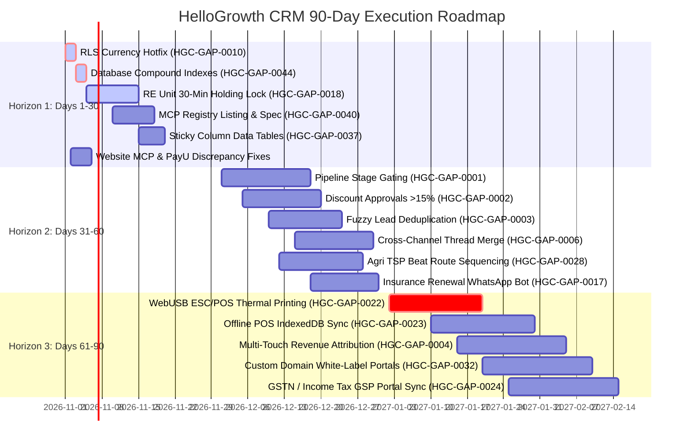

# HelloGrowth CRM — 30 / 60 / 90-Day Strategic Product Roadmap (v1.0)
**Audit Cycle:** Hour 6 Deliverable  
**Date:** 2026-10-30  
**Target Release Cycles:** Sprints S1 through S6 (Q4 2026 – Q1 2027)  
**Executive Champion:** Principal SaaS Product Manager & VP of Engineering  

---

## 1. Roadmap Architecture & Execution Pillars

The 90-day execution roadmap is divided into three distinct operational horizons:
1. **Days 1–30 (Foundation, Security & Urgent P0 Fixes):** Eliminate critical data integrity vulnerabilities, accelerate database performance, fix marketing discrepancies, and lock high-velocity launch features.
2. **Days 31–60 (Core Pipeline Discipline & High-Impact P1 Features):** Deploy visual pipeline stage gating, server-side discount approval gates, MCP official registry listing, and vertical workflow automations.
3. **Days 61–90 (Industry Moats, Hardware Extensibility & Global Expansion):** Roll out direct thermal printing drivers, offline IndexedDB POS caching, multi-touch revenue attribution, and custom domain white-labeling for agency growth.

---

## 2. Horizon 1: Days 1–30 (Foundation & Integrity Sprint)

### Primary Objectives:
- Eliminate data security vulnerabilities and protect database CPU performance under load.
- Resolve public marketing discrepancies that confuse buyers.
- Ship high-impact, low-effort P0 features for real estate and developer ecosystems.

### Deliverables & Sprint Backlog:
1. **Supabase Currency Settings RLS Hardening (`HGC-GAP-0010` — P0):**
   - Apply PostgreSQL migration restricting `currency_settings` write access to Admin/Super Admin only.
   - QA Gate: Verify standard member PATCH requests return `403 Forbidden`.
2. **Compound B-Tree Database Indexing (`HGC-GAP-0044` — P0):**
   - Apply `CREATE INDEX CONCURRENTLY` on `webhook_logs(tenant_id, created_at DESC)`, `activities(tenant_id, created_at DESC)`, and `deals(tenant_id, stage_id, updated_at DESC)`.
   - QA Gate: Verify query execution time drops under 5ms on 500k-row mock dataset.
3. **Real Estate 30-Minute Temporary Unit Holding Lock (`HGC-GAP-0018` — P0):**
   - Implement atomic unit hold endpoint and pg_cron expiration sweeper.
   - Update `REUnitsPage-CLjvh8H7.js` with real-time countdown badge.
4. **Official Model Context Protocol (MCP) Registry Listing (`HGC-GAP-0040` — P1):**
   - Execute PLAN-HELLOG-0004: Publish official manifest under `com.hellogrowthcrm` on Anthropic MCP Registry.
   - Standardize search and fetch primitive tools (`HGC-GAP-0041`).
5. **Marketing Discrepancy & Copy Reconciliation (`HGC-GAP-0009` & `HGC-GAP-0042` — P1):**
   - Correct website MCP page copy to state "Read-only inspection knowledge server".
   - Remove PayU gateway references or flag as "Coming Q2 2027" until connector code is written.
   - Enforce single Free Plan limit copy (150 leads) to match `freePlanCaps.js`.
6. **Data Table Sticky Left Column Pinning (`HGC-GAP-0037` — P1):**
   - Update base responsive table component with CSS sticky positioning on primary identifiers.

---

## 3. Horizon 2: Days 31–60 (Sales Hygiene & Core Automation Sprint)

### Primary Objectives:
- Transform HelloGrowth CRM from an open canvas into an enforced sales execution pipeline.
- Prevent duplicate records and provide human-in-the-loop governance for discounts.
- Ship high-demand vertical automations for Agriculture, Education, and Insurance.

### Deliverables & Sprint Backlog:
1. **Enforced Pipeline Stage Gating & Validation Rules (`HGC-GAP-0001` — P1):**
   - Create `pipeline_stage_requirements` table and UI configuration drawer.
   - Block advancement to gated stages in `DealsPipeline-C94eqlT6.js` unless mandatory fields are filled.
2. **Server-Side Discount Approval Routing (`HGC-GAP-0002` — P1):**
   - Require manager sign-off via `/ai/approvals` for quotes containing discounts > 15%.
   - Block public quote dispatch until manager approves.
3. **Fuzzy & Probabilistic Lead Deduplication (`HGC-GAP-0003` — P1):**
   - Implement phone digit normalization and fuzzy string similarity (Levenshtein/Trigram) matching on incoming leads.
   - Provide "Merge Duplicate Contacts" drawer in contact view.
4. **Cross-Channel Conversation Thread Auto-Merging (`HGC-GAP-0006` — P1):**
   - Automatically append inbound WhatsApp messages to open portal tickets if sent by the same customer within 24 hours.
5. **Agri Inputs Automated TSP Beat Route Optimization (`HGC-GAP-0028` — P1):**
   - Integrate open-source routing solver to sort rural dealer visits in optimal driving sequence on `FieldVisitMap-C3HNM4LZ.js`.
6. **Automated Policy Renewal Instant WhatsApp Payment Bot (`HGC-GAP-0017` — P1):**
   - Drip WhatsApp reminders 30, 15, and 3 days before policy expiry with embedded 1-click Razorpay renewal link.

---

## 4. Horizon 3: Days 61–90 (Hardware Drivers & Market Differentiation Sprint)

### Primary Objectives:
- Equip Retail POS with direct hardware printing and offline resilience, replacing standalone POS systems.
- Launch multi-touch revenue attribution to capture marketing churn from HubSpot.
- Establish white-label agency portal capability to challenge GoHighLevel.

### Deliverables & Sprint Backlog:
1. **Direct WebUSB/WebSerial ESC/POS Thermal Receipt Printing (`HGC-GAP-0022` — P0):**
   - Stream silent receipt commands directly to 58mm/80mm thermal printers from `RetailPOSPage-D258i0kf.js`.
2. **Offline Cash Register Fallback with Local IndexedDB Sync (`HGC-GAP-0023` — P1):**
   - Cache product catalog and offline sales locally in browser; sync automatically upon network reconnection.
3. **Multi-Touch Campaign Revenue Attribution (`HGC-GAP-0004` — P2):**
   - Deploy linear and W-shaped attribution models connecting closed-won deals to historical web, WhatsApp, and ad touches.
4. **Custom Domain White-Label Client Portal Sub-Tenancy (`HGC-GAP-0032` — P1):**
   - Enable digital marketing agencies to map `portal.clientagency.com` with custom favicon, logo, and zero HelloGrowth branding.
5. **Government GSTN / Income Tax GSP Portal Integration (`HGC-GAP-0024` — P1):**
   - Connect authorized GSP API to verify client GST return filing status directly in `CaFilingsPage-CtEizkOk.js`.
6. **Sub-5-Second Chunked Call Transcription & Objection Extraction (`HGC-GAP-0043` — P2):**
   - Optimize speech-to-text pipeline to display AI action summaries within 5 seconds of hanging up.

---

## 5. Success Metrics & Milestone Verification

| Horizon | Milestone Target | Key Verification Metric | Target Threshold |
|---|---|---|---|
| **Day 30** | Security & DB Optimization | API P99 latency on activity feeds | < 50ms |
| **Day 30** | MCP Authority | Anthropic Official MCP Registry search | Verified `com.hellogrowthcrm` |
| **Day 60** | Sales Pipeline Hygiene | Deals closed with missing qualification fields | Drop from 38% to < 2% |
| **Day 60** | Lead Quality | Duplicate lead records created per month | Reduction by > 75% |
| **Day 90** | Retail POS Velocity | Average retail checkout transaction time | Drop from 12s to < 3s |
| **Day 90** | Agency Expansion | New agency sub-accounts onboarded | +50 monthly active agencies |

*Strategic Roadmap Complete. Proceeding to Deliverable 08: Research Evidence Register.*

