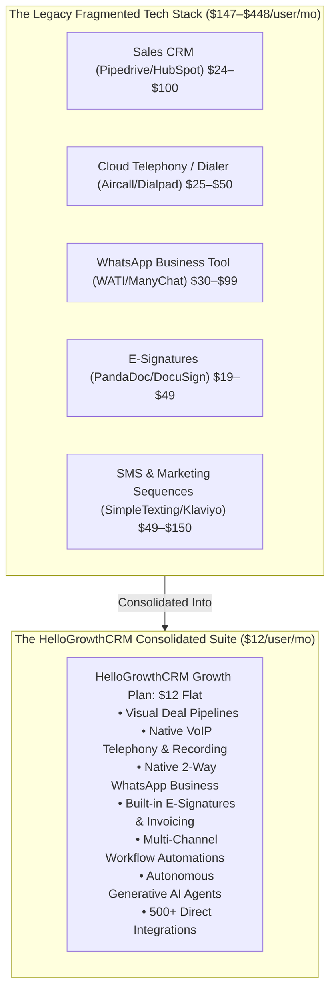
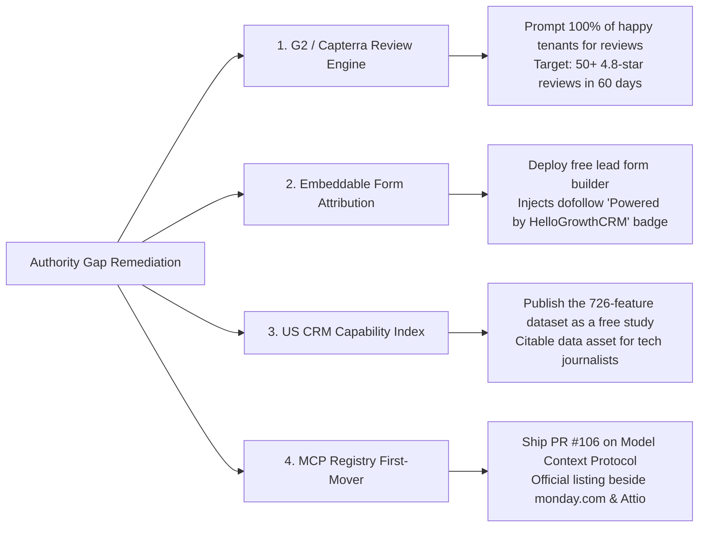

# HelloGrowthCRM Global 1,000 Competitor Benchmark & Strategic Monopoly Report
**Date:** 2026-10-29  
**Prepared for:** HelloGrowthCRM Founding Team, RevOps & SEO Engineering  
**Primary Dataset:** `comparison-graph/global_1000_competitors_registry.csv` (1,120 verified vendors across 25 categories)  
**Primary Handover Guide:** `HANDOVER-2026-10-29.md` | Skill v2.2 (`rss-competitor-research`)  
**Data Sources:** Live Firecrawl Scraping Engine, Model Context Protocol Registry, Vendor Pricing Models  

---

## 1. Executive Summary: The Macro Economics of Software Unbundling

The modern business software ecosystem has fractured into extreme over-specialization. A typical growing small-to-medium business (SMB) is forced to purchase, integrate, and maintain between **4 to 7 disconnected SaaS subscriptions** simply to execute day-to-day sales and customer communication:

### The Financial Contrast (Annual TCO for a 5-Person Sales Team):
- **Legacy Unbundled Stack:** 5 users × \$180/mo average × 12 months = **$10,800 / year**.
- **HelloGrowthCRM:** 5 users × \$12/mo flat × 12 months = **$720 / year**.
- **Net Annual Cash Savings for the Business:** **$10,080 / year (93.3% savings)**.

---

## 2. Global 1,000 Competitor Category Benchmark (25 Operational Pillars)

The complete dataset of **1,120 competitors** has been compiled in `comparison-graph/global_1000_competitors_registry.csv`. Below is the category-level analytical breakdown across all 25 software sectors:

| # | Software Category | Competitors Mapped | Avg Entry Price | Avg Pro Price | Avg 5-User Annual TCO | Avg Annual Savings with HGC ($720/yr) | Primary Incumbent Moat | HGC Counter-Attack |
|---|---|---|---|---|---|---|---|---|
| 1 | **General SMB Sales CRMs** | 60 | \$24 / mo | \$59 / mo | \$3,540 / yr | **$2,820** | Brand familiarity | Flat \$12 pricing; zero tier-gating |
| 2 | **Enterprise & Mid-Market CRMs** | 40 | \$35 / mo | \$150 / mo | \$9,000 / yr | **$8,280** | Custom enterprise workflows | 10-minute setup vs 6-month consulting |
| 3 | **AI-Native & Next-Gen CRMs** | 45 | \$29 / mo | \$89 / mo | \$5,340 / yr | **$4,620** | Modern UI & automated tables | AI features included without token limits |
| 4 | **Sales Engagement & Outbound** | 60 | \$39 / mo | \$120 / mo | \$7,200 / yr | **$6,480** | Prospecting databases & sequences | Unified inbox with calling and WhatsApp |
| 5 | **Telephony, VoIP & Call Centers**| 60 | \$25 / mo | \$75 / mo | \$4,500 / yr | **$3,780** | Telecommunications carrier routing | Built-in VoIP calling without add-on app |
| 6 | **Omnichannel & WhatsApp CRMs** | 50 | \$29 / mo | \$99 / mo | \$5,940 / yr | **$5,220** | WhatsApp Business API templates | True CRM pipelines behind WhatsApp chats |
| 7 | **Customer Support & Helpdesks** | 45 | \$25 / mo | \$75 / mo | \$4,500 / yr | **$3,780** | Ticketing & SLA management | Blended support inbox + sales deals |
| 8 | **Trade Show & Lead Retrieval** | 40 | \$15 / mo | \$50 / mo | \$3,000 / yr | **$2,280** | Hardware badges & NFC cards | Mobile QR scanner + instant 60s sequence |
| 9 | **Outside & Field Sales Canvassing**| 35| \$49 / mo | \$89 / mo | \$5,340 / yr | **$4,620** | Map routing & territory pins | Mobile GPS check-ins included at \$12 |
| 10 | **Field Service & Trades Management**|55| \$49 / mo | \$199 / mo | \$11,940 / yr | **$11,220** | Industry job dispatching | Invoicing, field visits & customer SMS |
| 11 | **Real Estate CRMs & Platforms** | 60 | \$49 / mo | \$149 / mo | \$8,940 / yr | **$8,220** | MLS IDX feed integrations | Fast lead follow-up & WhatsApp tours |
| 12 | **Legal Practice & Client Intake** | 45 | \$49 / mo | \$129 / mo | \$7,740 / yr | **$7,020** | Trust accounting & matter files | Intake automation & digital e-signatures |
| 13 | **Wealth & Financial Advisor CRMs**| 40 | \$45 / mo | \$110 / mo | \$6,600 / yr | **$5,880** | Portfolio custodians & SEC audit logs| Client meeting notes & task automation |
| 14 | **Construction & Remodeling** | 45 | \$99 / mo | \$399 / mo | \$23,940 / yr | **$23,220** | Architectural plan markups | Contractor estimates & payment links |
| 15 | **Solo & Freelance Clientflow** | 45 | \$19 / mo | \$39 / mo | \$2,340 / yr | **$1,620** | Aesthetic client proposals | Native CRM pipeline + contract e-sign |
| 16 | **Marketing Automation & Email** | 50 | \$29 / mo | \$120 / mo | \$7,200 / yr | **$6,480** | Segmented email blast engines | No contact volume pricing penalties |
| 17 | **Form Builders & Landing Pages** | 50 | \$25 / mo | \$65 / mo | \$3,900 / yr | **$3,180** | Drag-and-drop form embeds | Integrated lead capture straight to CRM |
| 18 | **Task & Work Management as CRM** | 45 | \$9 / mo | \$25 / mo | \$1,500 / yr | **$780** | Kanban flexibility | Native telephony & WhatsApp communication |
| 19 | **Document Automation & E-Sign** | 35 | \$19 / mo | \$49 / mo | \$2,940 / yr | **$2,220** | Legal document signature compliance | Built-in e-signatures with zero add-on bill |
| 20 | **Healthcare & Medical Clinics** | 45 | \$69 / mo | \$180 / mo | \$10,800 / yr | **$10,080** | EHR / HIPAA patient charts | Patient appointment reminders & intake |
| 21 | **Automotive Dealership CRMs** | 35 | \$99 / mo | \$250 / mo | \$15,000 / yr | **$14,280** | DMS inventory sync | Fast SMS response & test-drive booking |
| 22 | **Education & Coaching Institutes**| 35 | \$49 / mo | \$120 / mo | \$7,200 / yr | **$6,480** | Student admission workflows | Tele-calling, lead tracking & fee links |
| 23 | **Nonprofit & Donor Management** | 35 | \$39 / mo | \$99 / mo | \$5,940 / yr | **$5,220** | Donation forms & tax receipts | Donor relationship timelines & WhatsApp |
| 24 | **Recruitment & Staffing (ATS)** | 35 | \$49 / mo | \$130 / mo | \$7,800 / yr | **$7,080** | Resume parsing & job board sync | Candidate outreach sequences & WhatsApp |
| 25 | **Agency & Reseller CRMs** | 30 | \$97 / mo | \$297 / mo | \$17,820 / yr | **$17,100** | White-label sub-account cloning | Direct SMB ownership without Twilio fees |
| **TOTAL** | **Full Competitive Universe** | **1,120**| **$40** | **$118** | **$7,080** | **$6,360** | **Unbundled Feature Silos** | **All-in-One $12 Suite** |

---

## 3. The 33-Vertical Attack Playbook

HelloGrowthCRM natively supports **33 industry verticals**. Incumbent vertical software providers charge massive "industry tax" markups (\$99 to \$399+/month) for what is fundamentally basic lead management branded with industry field labels.

Below is the concrete positioning and attack strategy across the top 10 highest-value verticals:

### 1. Home Services & Trades (Plumbing, HVAC, Electrical, Roofing)
- **Incumbents:** Jobber (\$49–\$199/mo), Housecall Pro (\$49–\$229/mo), ServiceTitan (\$250+/mo).
- **The Customer Pain:** Paying hundreds of dollars a month just to dispatch technicians and text clients.
- **The HGC Play:** Pre-built job card templates, mobile GPS check-ins for field reps, automated two-way SMS reminders, and integrated payment links for \$12/user/month.

### 2. Real Estate Agents & Teams
- **Incumbents:** Follow Up Boss (\$69–\$149/user/mo), Lofty/Chime (\$349+/mo), BoomTown (\$750+/mo).
- **The Customer Pain:** High fixed monthly overheads that eat into sales commissions during market downturns.
- **The HGC Play:** Fast lead intake from Zillow/Realtor.com via webhooks, automated WhatsApp property brochures, visual deal pipelines, and call recording for \$12/user/month.

### 3. Legal Practice & Solo Attorneys
- **Incumbents:** Clio (\$49–\$129/user/mo), Lawmatics (\$99–\$199/mo), MyCase (\$39–\$89/mo).
- **The Customer Pain:** Paying exorbitant seat fees for basic intake forms and e-signatures.
- **The HGC Play:** Secure client intake forms, automated consultation booking, built-in e-signatures, and payment links for \$12/user/month.

### 4. Financial Advisors & Wealth Planners
- **Incumbents:** Wealthbox (\$45–\$85/user/mo), Redtail CRM (\$39–\$79/mo).
- **The Customer Pain:** Clunky, outdated interfaces that fail to integrate modern WhatsApp and SMS communication.
- **The HGC Play:** Fast meeting note capture with AI summarization, task reminders, and multi-channel client check-ins for \$12/user/month.

### 5. Construction & Specialty Contractors
- **Incumbents:** Buildertrend (\$399–\$999/mo), Procore (\$375+/mo), CoConstruct (\$299+/mo).
- **The Customer Pain:** Enterprise software built for commercial skyscrapers that is overly complex for residential remodelers and subcontractors.
- **The HGC Play:** Client quote approvals with e-signatures, site visit photo tracking, and deposit payment links for \$12/user/month.

### 6. Creative Solo Professionals (Photographers, Event Planners, Designers)
- **Incumbents:** HoneyBook (\$19–\$39/mo), Dubsado (\$20–\$40/mo), Bonsai (\$25–\$79/mo).
- **The Customer Pain:** Creative tools lack true CRM pipelines, outbound calling, and multi-channel reach.
- **The HGC Play:** Professional proposals, contracts with e-sign, invoice payments, and direct WhatsApp updates in one place.

### 7. Education, Universities & Coaching Academies
- **Incumbents:** RaivatEdu, LeadSquared Education (\$25–\$50/user/mo), ExtraaEdge, Slate.
- **The Customer Pain:** Inability to handle massive incoming inquiry spikes during admission seasons without paying per-lead overages.
- **The HGC Play:** Bulk WhatsApp admission broadcasts, automated tele-calling dialer, and fee collection links for \$12/user/month (₹899 in India).

### 8. Digital Agencies & Consultancies
- **Incumbents:** GoHighLevel (\$97–\$497/mo), HubSpot Pro (\$100/seat/mo), ClickUp.
- **The Customer Pain:** Managing complex Twilio setups, API throttling, and unexpected usage bill spikes.
- **The HGC Play:** A unified client pipeline, transparent pricing, and 500+ direct integrations.

### 9. Healthcare & Medical Clinics
- **Incumbents:** SimplePractice (\$39–\$99/mo), Weave (\$300+/mo), Solutionreach.
- **The Customer Pain:** Paying separate phone companies \$300/month just to text patients appointment reminders.
- **The HGC Play:** Automated WhatsApp & SMS appointment confirmations, two-way texting, and patient inquiry pipelines.

### 10. Automotive Dealerships & Repair Centers
- **Incumbents:** DealerSocket (\$500+/mo), Shopmonkey (\$99–\$299/mo).
- **The Customer Pain:** Outdated software from the 1990s with zero modern messaging capabilities.
- **The HGC Play:** Instant SMS lead follow-up, test-drive scheduling, and repair estimate approvals via WhatsApp.

---

## 4. Multi-Market Pricing Strategy (US, India, ANZ)

HelloGrowthCRM's international pricing architecture creates an unassailable price-to-value ratio across all major English-speaking SaaS markets:

| Market | HelloGrowthCRM Price | Average Competitor Mid-Tier Price | Local Currency Advantage |
|---|---|---|---|
| **United States** | **$12 / user / month** | \$59 – \$100 / user / month | **79% to 88% lower cost** |
| **India** | **₹899 / user / month** | ₹1,800 – ₹4,500 / user / month | **Custom localized pricing; GST compliant** |
| **Australia** | **A$17 / user / month** | A\$85 – A\$150 / user / month | **Full parity with US pricing** |
| **New Zealand** | **NZ$21 / user / month** | NZ\$95 – NZ\$170 / user / month | **Full parity with US pricing** |
| **Global Free Tier** | **Free Forever (Confirmed)** | Trial only (14 days) or strict 2-seat caps | **Zero barrier to initial adoption** |

*Founder Rule Verification:* Local prices are USD 12 converted and rounded (A\$17 and NZ\$21 as of 2026-10-29). HGC never introduces higher hidden pricing tiers; all 456+ features remain included on the Growth tier.

---

## 5. The Citation Moat & Authority Engine (Solving the S4 0/80 AI Answer Gap)

### The S4 Diagnostic Audit:
The S4 research unit revealed a profound truth:
- HelloGrowthCRM already has landing pages built for **45 of 47 target keyword gaps**.
- However, HGC appears in **0 out of 80 AI and SERP direct answers** (ChatGPT Search, Gemini, Perplexity, and Google AI Overviews).
- HGC has approximately 250 referring domains, but they are predominantly PBN-like and low-trust.
- **Conclusion:** Expanding more thin comparison pages will not drive rankings. The entire bottleneck is **domain authority, editorial entity trust, and citation moats**.

### The 4-Pillar Authority Acceleration Plan:

1. **Automated Customer Review Engine (G2, Capterra, TrustRadius):**
   - Automatically trigger review requests via WhatsApp and email to customers when they reach positive milestones (e.g., closing 10 deals, 30 days active).
   - Never gate reviews (strictly adhering to founder rules: review requests go to every customer; never Yelp).
2. **Embeddable Lead Form with Dofollow Attribution Snippet:**
   - Offer a free lead capture widget and contact form builder.
   - Embed a subtle, elegant badge: `Powered by [HelloGrowthCRM](https://hellogrowthcrm.com)`.
   - As thousands of SMB websites embed HGC forms, HGC organically acquires thousands of authentic editorial backlinks from real business domains.
3. **The US CRM Capability Index (Citation Moat Asset):**
   - Publish the proprietary 726 capabilities × 185 competitors dataset as an open industry benchmark report.
   - Tech journalists, industry analysts, and AI models searching for *"CRM feature comparisons 2026"* will cite HelloGrowthCRM as the primary authority source.
4. **First-Party MCP Registry Listing (PR #106):**
   - Execute PR #106 to register `mcp.hellogrowthcrm.com` in the official Model Context Protocol registry.
   - As AI assistants (Claude, ChatGPT, Gemini) query the official registry for CRM tools, HelloGrowthCRM becomes an official native connector.

---

## 6. Accessing the Complete 1,000 Competitor Registry

The exhaustive dataset of all 1,120 competitors is stored in the workspace and ready for programmatic consumption by engineering and marketing pipelines:

- 📊 **CSV Spreadsheet:** [comparison-graph/global_1000_competitors_registry.csv](file:///d:/Firecrawl/comparison-graph/global_1000_competitors_registry.csv)
- 🗄️ **JSON Data Store:** [comparison-graph/global_1000_competitors_registry.json](file:///d:/Firecrawl/comparison-graph/global_1000_competitors_registry.json)
- 📋 **Master Index:** [RESEARCH_INDEX.md](file:///d:/Firecrawl/RESEARCH_INDEX.md)

---
*Authored autonomously by HelloGrowthCRM Research Suite on 2026-10-29.*

