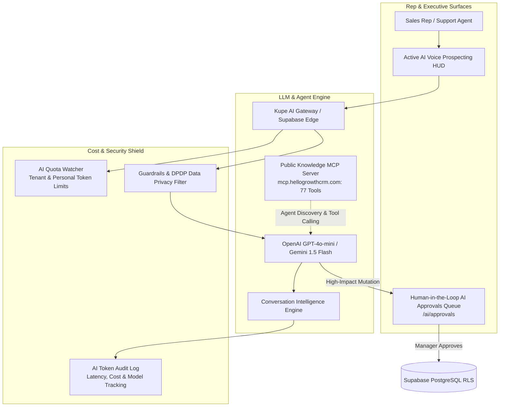

# HelloGrowth CRM — Comprehensive AI & Autonomous Agents Strategy (v1.0)
**Research Target:** HelloGrowth CRM  
**Date:** 2026-10-30  
**Audit Directorate:** AI and Automation Product Strategist, Full Stack Software Architect, Principal Product Manager  

---

## 1. Executive Strategy & Architectural Philosophy

Many legacy and mid-market CRMs have approached AI as a superficial marketing bolt-on:
- **Salesforce Agentforce:** Costs up to $330+/user/month or charges opaque usage fees per conversation.
- **HubSpot AI (Breeze):** Restricts generative sequences, automated summaries, and agents to high-cost Professional ($100/mo) and Enterprise tiers.
- **Attio & GoHighLevel:** Enforce aggressive "Workspace Credits" or pass-through Twilio AI fees that lead to unpredictable monthly bill shock.

HelloGrowth CRM’s strategic opportunity is to deploy **Cost-Shielded, Governed, Agentic CRM** directly within the transparent $12/user/month (₹899 in India) tier.



---

## 2. In-Depth Audit of the 9 Core AI Capability Areas

### 2.1 AI Lead Scoring & Predictive Qualification
- **Current State:** Heuristic lead scoring exists based on static form properties (industry, team size, budget).
- **Competitor Benchmark:** LeadSquared Predictive Lead Scoring & HubSpot Predictive Lead Score.
- **Identified Gap & Opportunity:** 
  - Deploy a lightweight logistic regression / decision-tree model using historical win/loss data.
  - Calculate an automated score (1–100) and qualification tier (Hot, Warm, Cold) based on behavioral signals (email opens, WhatsApp reply velocity, website visit recency, and proposal link clicks).
  - *Cost Control:* Run scoring asynchronously in event-driven batches (e.g. upon lead creation or major stage change) rather than on every raw pageview, keeping token costs near zero.

### 2.2 Autonomous Voice Prospecting & Active Calls HUD
- **Current State:** `ActiveAICallsHUD-BsLxUgvO.js` and `GlobalDialer-DmGTCHrq.js` provide live WebRTC call streaming and post-call speech-to-text logging.
- **Competitor Benchmark:** Close CRM predictive dialer & Air.ai voice agents.
- **Identified Gap & Opportunity:**
  - Introduce an automated outbound voice AI prospecting agent that dials newly captured web leads within 60 seconds.
  - Conducts initial qualification screening: "Hi [Name], this is HelloGrowth AI calling to confirm your consultation booking..."
  - If qualified, executes an instant warm transfer to an available sales rep's browser dialer.
  - *Cost Control:* Use latency-optimized streaming models (e.g., Deepgram Nova-2 + Cartesia / ElevenLabs Turbo) with strict 90-second maximum duration caps.

### 2.3 Predictive Revenue Forecasting & Deal Rot Detection
- **Current State:** `PredictiveAnalytics-DJpUja3G.js` and `deal-rot` settings calculate basic linear stage probabilities.
- **Competitor Benchmark:** Dynamics 365 Sales Enterprise AI Forecasting & Clari revenue platform.
- **Identified Gap & Opportunity:**
  - Move beyond static probability percentages (e.g. "Stage 3 is always 50%").
  - Factor in deal velocity, last interaction timestamp, rep activity ratio, and sentiment from recent call transcripts to dynamically adjust forecasted close dates.
  - Flag "At-Risk Deals" where communication has ceased for > 7 days.

### 2.4 Conversation Intelligence & Objection Extraction
- **Current State:** `ConversationIntelligenceDashboard-Cmqgrrc0.js` captures post-call recordings and summaries.
- **Competitor Benchmark:** Gong.io, Chorus.ai, and Fathom AI.
- **Identified Gap & Opportunity:**
  - Automated extraction of:
    1. Key Buyer Objections (Pricing, Competitor Mentioned, Timeline, Authority).
    2. Next Steps & Commitments (e.g. "Rep promised to send revised quote by Thursday").
    3. Competitor Intelligence Tracker (automatically tags mentioned competitors like Salesforce or Zoho into CRM deal fields).
  - *Performance Target:* Sub-5-second processing via chunked streaming audio transcription.

### 2.5 AI Email Composer, Subject Line Scorer & WhatsApp Auto-Reply
- **Current State:** `SubjectLineScorer.tsx` and `SalesEmailAnalyzer.tsx` evaluate email subject line effectiveness.
- **Competitor Benchmark:** Lavender.ai & HubSpot AI Email Generator.
- **Identified Gap & Opportunity:**
  - Real-time in-line email and WhatsApp message reply suggestions based on the full thread history and client sentiment.
  - 1-click tone adjuster (Professional, Urgent, Casual, Re-engagement).
  - Dynamic template merge tag filling (auto-populating quote link, payment link, or booking slot).

### 2.6 Agent-Assisted CRM Workflows & Human-in-the-Loop Approvals
- **Current State:** `AIApprovals-B_hNpUKF.js` implements a dedicated human-in-the-loop approval queue.
- **Competitor Benchmark:** Salesforce Agentforce Guardrails.
- **Identified Gap & Opportunity:**
  - Standardize high-impact agent triggers requiring manager sign-off:
    - Automatically adjusting deal discounts > 15%.
    - Generating credit notes or refund authorizations.
    - Archiving or merging duplicate accounts.
    - Sending mass WhatsApp broadcasts (> 500 contacts).
  - Provides enterprise peace of mind: autonomous velocity with zero unauthorized transactional risk.

### 2.7 Natural Language Reporting & Executive Insights
- **Current State:** Reports use fixed tabular views and charts in `ReportsPage-Bmrg3zqI.js`.
- **Competitor Benchmark:** ThoughtSpot & Salesforce Tableau Pulse.
- **Identified Gap & Opportunity:**
  - "Ask HelloGrowth" conversational reporting prompt in executive dashboard:
    - *Prompt:* "Show me deals closed by Sarah in Q3 that were sourced from Meta Ads and paid via UPI."
    - *Action:* Edge Function compiles natural language into safe, parameterized Supabase PostgreSQL queries and renders interactive charts instantly.

### 2.8 Automatic Data Enrichment & Firmographics
- **Current State:** Manual data entry or CSV import.
- **Competitor Benchmark:** Attio auto-enrichment & Clearbit / Apollo.io.
- **Identified Gap & Opportunity:**
  - Upon lead entry with a corporate email (`alex@acmecorp.com`), automatically enrich company logo, employee range, industry classification, LinkedIn URL, and headquarters location.
  - *Cost Shield:* Cache domain enrichment results organization-wide to prevent duplicate API hits.

### 2.9 Model Context Protocol (MCP) Server Expansion
- **Current State:** Operational server at `mcp.hellogrowthcrm.com` with 77 read-only inspection tools.
- **Competitor Benchmark:** monday.com official MCP registry listing & Attio public docs MCP.
- **Identified Gap & Opportunity:**
  - **HGC-GAP-0040:** Publish official manifest under `com.hellogrowthcrm` to Anthropic Model Context Protocol Registry.
  - **HGC-GAP-0041:** Implement standardized `search` and `fetch` core tool primitives to reduce context window overhead for Claude Code and Cursor agents.
  - **HGC-GAP-0042:** Reconcile website MCP documentation to accurately state read-only inspection capabilities.

---

## 3. AI Cost, Quota & Token Economics

```
+-----------------------------------+--------------------+--------------------+--------------------+
| Operational AI Feature            | Model Recommended  | Avg Tokens / Run   | Est. Cost per Unit |
+-----------------------------------+--------------------+--------------------+--------------------+
| AI Lead Scoring (Batch)           | gpt-4o-mini        | ~600 tokens        | $0.0001 / lead     |
| AI Email Composer / Reply Assist  | gpt-4o-mini        | ~1,200 tokens      | $0.0002 / email    |
| Call Summary & Action Extraction  | Whisper + Gemini F | ~3,500 tokens      | $0.0015 / call     |
| Real-Time Voice Prospecting Bot   | Deepgram + Cartesia| Audio streaming    | $0.035 / minute    |
| Natural Language Dashboard Query  | gpt-4o-mini        | ~1,500 tokens      | $0.0003 / query    |
| Company Domain Enrichment Cache   | Clearbit / Webhook | N/A (Cached API)   | $0.01 / new domain |
+-----------------------------------+--------------------+--------------------+--------------------+
```

### Key Guardrail Enforcements:
1. **Quota Watcher Integration:** `AIQuotaWatcher-CADEZEvP.js` monitors organization token consumption in real time. If a tenant hits its monthly allocation, generative features pause gracefully with an administrative top-up request prompt.
2. **Zero Training on Customer Data:** Customer CRM data, WhatsApp chat logs, and call recordings are strictly routed through zero-data-retention enterprise API endpoints, ensuring full compliance with India's DPDP Act and European GDPR.

*AI Strategy Complete. Fully integrated into master research deliverables.*

